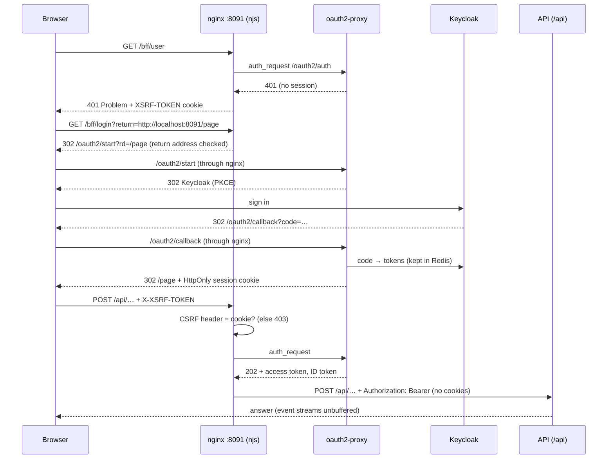

# Light BFF: oauth2-proxy and nginx

A Backend for Frontend for Quadrava made of configuration only (ADR-27, `docs/adr-27-bff-only-with-light-bffs.md`):
[oauth2-proxy](https://oauth2-proxy.github.io/oauth2-proxy/) signs the user in with OpenID Connect and keeps the
session and the tokens; nginx is the only address the browser talks to, asks oauth2-proxy whether each call has a session
(`auth_request`) and adds what oauth2-proxy lacks with a short njs script (`nginx/bff.js`): the CSRF cookie and header,
`/bff/user`, `/authz/capabilities`, `/authz/check`, `/authz/roles` and the choice of the operational role
(`POST /bff/role`, ADR-28). It follows `contracts/bff.yaml` (0.6.0) and passes the BFF and authorization conformance
kits, so an application can move between it, the minimal Node BFF and the reference BFF on authz-library
without touching its JSON.

**An example to start from, not meant for production as it is**: plain HTTP, development credentials in
`compose.yaml` (labelled as such), the development Keycloak of `idp/`, the demo API. A real application uses
authz-library (ADR-26) or its own BFF, or takes this one and makes it its own (TLS, secrets, its identity provider, its
services).



## Files

| File | What it is |
| --- | --- |
| `compose.yaml` | nginx (official image, njs included), oauth2-proxy, Redis for its sessions, the runtime image |
| `nginx/nginx.conf` | Main configuration: the njs module (QuickJS engine) and the server below |
| `nginx/templates/bff.conf.template` | The server: which paths need a session, where each goes, the CSRF check. The image fills in the `${…}` values from the environment of `compose.yaml` when it starts |
| `nginx/bff.js` | The njs glue: CSRF cookie and check, login with a checked return address, user, permissions, operational role, logout |
| `role-permissions.json` | Permissions per role (mounted, editable) |

## Running it

Docker, and from the root of the repository:

```bash
(cd idp && docker compose up -d)                           # Keycloak (realm quadrava) on 8180
(cd frontend && node tools/demo-api.mjs) &                 # the demo API on 8084 (after npm ci in frontend/)
(cd docker/bff-lite-proxy && docker compose up -d)         # nginx on 8091
```

Open http://localhost:8091 and sign in as `operator`, `manager` or `administrator` (password = user name, development
realm). The runtime image shows the demo with its examples; their data, writes and live boards go through this BFF to
the demo API.

The realm has a client for this BFF (`quadrava-bff-lite-proxy`, redirect URI `http://localhost:8091/oauth2/callback`).
Keycloak imports the realm only when its container is created: if it was created before this client existed, recreate
it with `cd idp && docker compose down && docker compose up -d` (users and sessions start again from the file).

oauth2-proxy runs in the network namespace of nginx (`network_mode: service:nginx`): after recreating or restarting
nginx alone, recreate oauth2-proxy too (`docker compose up -d --force-recreate oauth2-proxy`), or simply
`docker compose down && docker compose up -d`.

The conformance kit, from `frontend/`:

```bash
npm run conformance:bff -- --bff http://localhost:8091 --return http://localhost:8091/ --user administrator --password administrator
```

and the authorization kit, with the cookies of two signed-in sessions of different users (for example copied from the
browser, or from `bffLogin` of `tools/conformance-lib.mjs`):

```bash
npm run conformance:authz -- --authz http://localhost:8091 --app demo --cookie "…" --other-cookie "…"
```

(`npm run conformance` checks the services of the local stack on their own ports; this BFF is checked with the line
above.)

### Configuration

| Variable (`compose.yaml`) | Meaning |
| --- | --- |
| `BFF_ORIGIN` (nginx) | Origin of the pages as the browser sees it: return addresses must have it, the logout comes back to it |
| `OIDC_ISSUER`, `OIDC_CLIENT_ID` (nginx) | Issuer and client of the identity provider, for the address of its logout |
| `API_UPSTREAM` (nginx) | The service behind `/api` |
| `RUNTIME_UPSTREAM` (nginx) | The runtime image, served at `/` |
| `KEYCLOAK_UPSTREAM` (nginx) | Development only: the Keycloak of `idp/`, reached through a relay (below) |
| `OAUTH2_PROXY_*` | oauth2-proxy: provider, client and secret, redirect URI, cookie (name, secret, length of the session, renewal of the tokens), Redis |

Keycloak of `idp/` runs on the host. So that the tokens have the same issuer for the browser and for oauth2-proxy
(`http://localhost:8180/realms/quadrava`, which the demo API also checks), nginx listens on `127.0.0.1:8180` inside its
own network namespace and relays to the host with `Host: localhost:8180`; oauth2-proxy, in the same namespace, reaches
Keycloak at the address the browser uses. With an identity provider that has a real host name, drop that server and point
`OAUTH2_PROXY_OIDC_ISSUER_URL` at it.

Behind https: `OAUTH2_PROXY_COOKIE_SECURE=true`, `BFF_ORIGIN=https://…` (the CSRF cookie then gets `Secure` too), a new
`OAUTH2_PROXY_COOKIE_SECRET` and client secret, and the redirect URI of the client.

## Roles and permissions

The roles are the realm roles of the user in the access token (`realm_access.roles`), without the ones Keycloak gives
everybody (`default-roles-*`, `offline_access`, `uma_authorization`). They are listed in `/bff/user` and give the
permissions of `role-permissions.json`:

```json
{
  "roles": {
    "user": { "label": "User", "base": true, "permissions": ["showcase.components.read"] },
    "operator": { "label": "Operator", "permissions": ["orders.order.read", "invoices.invoice.read"] },
    "manager": { "label": "Manager", "permissions": ["orders.order.read", "orders.order.write", "orders.order.approve"] }
  }
}
```

A role is an object with its `permissions` (`domain.resource.action`, contracts/authz.yaml), a `label` for the menu
(its identifier if absent) and `base`; a plain list of permissions, the earlier format, is an operational role labelled
with its identifier. The permissions are the same for every application (`app` is required but not used).

**Operational roles** (ADR-28): a `base` role always applies, the others are chosen one at a time. A user with
operational roles works as one of them: the permissions are those of the base roles plus the active one, `/bff/user`
lists `operationalRoles` and `currentRole`, and `POST /bff/role` with `{ "role": "<id>" }` (and the CSRF token)
switches. Without operational roles, the user gets the union of the permissions of all their roles, as before, and the
user has no role fields. The `role` that a page sends to `/authz` and its `X-Active-Role` change nothing.

oauth2-proxy has no place for data of the application in its session, so the active role is kept in an HttpOnly
cookie (`quadrava_lite_role`, `SameSite=Lax`, 30 days) that `POST /bff/role` sets. It is not trusted: at every call
njs takes it only if it names an operational role of the user in the token, otherwise the first one (in alphabetical
order). So the cookie can only choose among the user's own roles, as the switch does; it also makes the next login of
the same browser open on the last role used. The file is read again at every call: after editing it, the next
`/authz/capabilities` answers with the new permissions and a new `X-Permissions-Version`, and the runtime reloads them.
Another identity provider puts the roles elsewhere (`groups`, `roles`, a claim of a client): change `rolesOf` in
`nginx/bff.js`.

The permissions only drive the interface: the services behind `/api` check every request with the token they receive.

## What it does

| Contract | How |
| --- | --- |
| Session missing or expired: `401`, never a redirect | Every location needs a session (`auth_request` to `/oauth2/auth` of oauth2-proxy) unless it is public (the runtime files, the login); without one nginx answers `401` in Problem format |
| `GET /bff/login?return=` | njs accepts only a return address with the origin of `BFF_ORIGIN` (otherwise `400` Problem, no open redirect) and sends its path to `/oauth2/start?rd=` |
| `GET /bff/user` | njs, from the claims of the access token: `name`, `username`, `email`, `roles`, and `operationalRoles` and `currentRole` when the user has operational roles; no tokens |
| `POST /bff/role` | Needs the session and the CSRF token. njs checks the body (`400`) and that the role is an operational role of the user (`404`), sets the role cookie and answers `204` with the new `X-Permissions-Version` |
| `POST /logout` | Needs the session and the CSRF token. njs closes the session of oauth2-proxy (cookie and tokens in Redis) and answers `{ "redirect": … }` with the logout of Keycloak (`id_token_hint`, back to `BFF_ORIGIN`) |
| CSRF | `XSRF-TOKEN` cookie (not HttpOnly, `SameSite=Lax`, random) on any answer to a browser that has none, so with the first one of a session at the latest; a `POST`, `PUT`, `PATCH` or `DELETE` whose `X-XSRF-TOKEN` header is missing or different answers `403` Problem before anything else |
| `/api/…` | Forwarded with `Authorization: Bearer <access token>` and the active role in `X-Active-Role` (none without operational roles; never the one of the page), without the cookies of the browser; `Accept-Language` and the other headers pass on; no buffering and a read timeout of 24 hours for event streams |
| `/authz/capabilities`, `/authz/check` | njs, from the roles, the active role and `role-permissions.json`, with `X-Permissions-Version`; a `role` of the page is ignored |
| `/authz/roles` | njs: the roles of the user that the file knows, with `label` and `base` |
| Tokens | Kept in Redis by oauth2-proxy (the browser has only an HttpOnly cookie with the session ticket); renewed with the refresh token when the session is older than 4 minutes (Keycloak's access tokens last 5) |

`/telemetry/` is accepted and dropped (`204`): there is no telemetry service here. To keep the reports, forward it to a
service of `contracts/telemetry.yaml` like `/api/`. Only `/oauth2/start` and `/oauth2/callback` of oauth2-proxy are
reachable from the browser: its sign-out with a `GET` is not, so a link from another site cannot end the session.

## What it does not do

- **Tenants** (optional part of the contract): no `tenants` in the user and no `POST /bff/tenant`.
- **Back-channel logout**: signing out of Keycloak elsewhere does not end the session here until its tokens can no
  longer be renewed (oauth2-proxy finds out when it renews them, at most 4 minutes later). The reference BFF has it.
- **Recent login** (`max_age`): `/bff/login` ignores `max_age`, because oauth2-proxy does not pass it to Keycloak with
  this configuration; this BFF never answers `recent-login-required`. A service behind it that asks for a recent login
  would not get one.
- **Return pages on other origins**: the applications are the pages of `BFF_ORIGIN`. Another origin would need its
  check in `returnPath` (`nginx/bff.js`) and `OAUTH2_PROXY_WHITELIST_DOMAINS`.
- **Origin check on writes**: the CSRF token is the protection, plus `SameSite=Lax` on the cookies.
- **Production concerns**: TLS, real secrets, one Redis shared by more oauth2-proxy instances, limits and logs to your
  standards. The access log of nginx has methods and paths only, no query strings, cookies or tokens.
