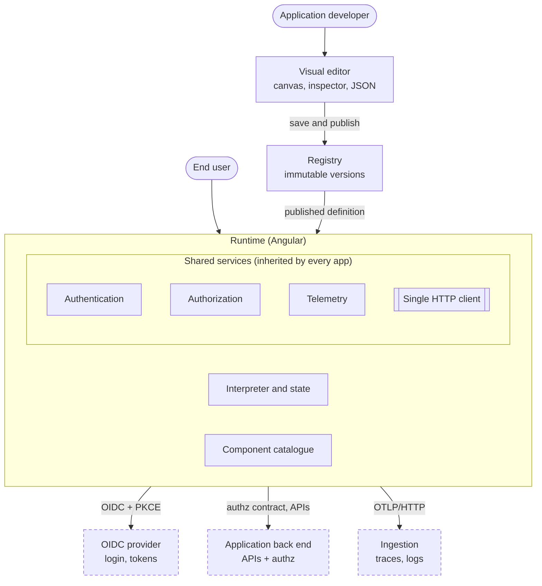
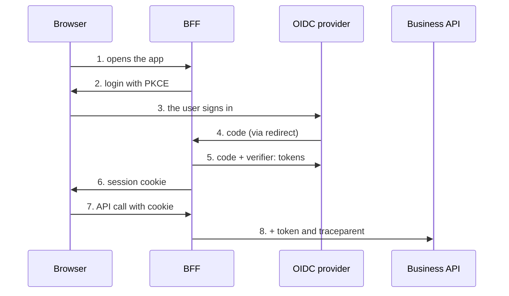

# LowCode Platform — Architecture

Simone Ramaccini · 7 October 2026

## 1. Summary and architectural principles

The platform is made of three parts (editor, registry, runtime) that revolve around a single contract: the JSON language with its JSON Schema. Everything else, from security services to telemetry, is built once in the runtime and inherited by every application.

| Principle | What it means | Practical consequence |
| --- | --- | --- |
| The JSON is the single source of truth | Editor and runtime read and write the same document | No internal editor format; you can move from visual to text without losses |
| Interpret, do not generate code | The runtime reads the JSON at run time | Changes visible immediately, faithful preview; security comes from validation before publication |
| The front end is never the enforcement point | Hiding is user experience, not protection | The back end always rejects and filters; the runtime handles 403s uniformly |
| Open standards everywhere | OIDC, OpenAPI, OpenTelemetry, W3C Trace Context | No proprietary protocol; integration with existing tools |
| Cross-cutting rules are written once | One HTTP client, one authorization service, one telemetry | The application author cannot forget tokens, tracing or error handling |
| Controlled escape hatch | Custom components registrable through a contract | Unforeseen cases do not force anyone to leave the platform |
| Governable by construction | JSON that can be versioned, compared and reviewed | History, diff, review and rollback as with code |

**Product boundary.** On the back-end side the platform delivers only the REST interfaces (OpenAPI specifications for authorization, telemetry and registry) and a reference implementation of them. The reference implementation demonstrates the contracts and serves as a test bench: it is not a production service. Every customer implementation must pass the same conformance tests (proposal: a contract test kit shipped with the platform).

## 2. Overview

The platform has three parts of its own (editor, registry, runtime), a layer of shared services inside the runtime and two REST contracts that customer back ends implement. The identity provider and the observability system are external and standard.



*A single HTTP client applies security and tracing to every call. Dashed = outside the platform.*

The runtime is the only component in contact with the end user; editor and registry serve those who build applications, and everything leaving the runtime goes through the single HTTP client.

## 3. Definition language and JSON Schema

The language has three levels, so that the core stays small and stable while the catalogue grows.

| Level | Content | Who evolves it |
| --- | --- | --- |
| Core | Application, screen, component node, data source, action, expression, state | Platform team, with rare and controlled changes |
| Component catalogue | One JSON Schema per component type: properties, events, insertion points | Platform team and, for custom components, application teams |
| Extensions | Components, actions and expression functions added by packages | Anyone, through a registration contract |

**JSON Schema as the engine of the editor.** Since every component describes its properties with a schema, the editor generates the property panel and the validation on its own: adding a component requires no change to the editor.

**Versioning.** Every document carries `schemaVersion`. Migrations are pure "version N to N+1" functions, applied by the registry on publication and by the runtime on load if needed. The proposal is for the runtime to support the current and the previous version, with older ones migrated automatically.

**Validation in three places.** In the editor while writing, on publication in the registry (it blocks invalid documents) and on load in the runtime (defence in depth).

**Reuse.** Reusable fragments (for example a shared block of filters) referenced with `$ref`, to avoid duplication across screens.

**Binding and expressions.** Dynamic values use the `{{ ... }}` syntax; everything between double braces is an expression in the language chosen in section 5.

**Linked documents: theme and menu.** Besides screens there are two documents with their own schema. The *theme* contains only design tokens (colours, font, radius, spacing, control height, compact or comfortable density), validated with a restrictive pattern to prevent CSS injection; the runtime applies them as `--lc-*` CSS variables, so components carry no colours of their own. A bridge (theme-bridge, in the components library) then translates the primary, success and error colours into NG-ZORRO's --ant-\* variables, computing the tonal scale, and for dark themes loads the library's dark stylesheet; this way switching theme at run time also applies to its components. The *navigation* lists the areas, the functional parts of the application, with one menu each, up to three fixed levels imposed by the schema (group, subgroup, item); an item points to a screen with optional parameters and may have `requires` (permission) and `visibleIf` (CEL). A group or area with no visible items is not shown.

**Application shell, driven by the theme.** The overall look follows the Ant Design Pro style: on the left a full-height side bar, with the logo at the top, above the area selector and the multi-level menu, collapsible to icons only (groups open in a popup) with a round button on its edge; at the top the bar with the demo's choices and, on the right, the user menu (avatar, name and application items, with sign-out always as the last item); in the centre the page header (breadcrumbs derived from the menu, title, optional description) and the content in cards on a light grey background. None of this is fixed in the code: the theme document has an optional `layout` group with the colours, tone (light or dark) and width of the side bar, the colours and height of the top bar, the colours of the page header and the content padding, which become the variables `--lc-sider-*`, `--lc-header-*`, `--lc-page-header-*` and `--lc-content-padding`. If missing, they are derived from the base colours (light side bar as in Ant Design Pro). The repository provides three themes: light, classic (dark blue side bar) and dark. Long menu items wrap instead of being truncated.

## 4. Runtime

The runtime is an Angular application (current version, standalone components and signals) that interprets the JSON. It has modules with separate responsibilities, so that each can be replaced and tested on its own.

| Module | Responsibility |
| --- | --- |
| Loader | Downloads the definition from the registry, validates it, migrates it if needed |
| Interpreter | Turns the tree of JSON nodes into Angular components, looking them up in the catalogue by type |
| State | Keeps the screen state (filters, selection, form values) in a reactive store; exposes `state` to expressions |
| Data layer | Runs the declared data sources, with caching, invalidation and paging; knows nothing about the UI |
| Action engine | Runs the sequences of steps, with error handling and cancellation |
| Expression evaluator | Runs expressions in the chosen language, in a sandbox (section 5) |
| Shared services | Authentication, authorization, telemetry and HTTP client, described in sections 6, 7 and 8 |
| Component catalogue | Registry of the available components, each with its own schema and declared properties. The standard components are built on the NG-ZORRO UI library (ADR-11) |

**The single HTTP client is the key point.** Every call, business or technical, goes through it: it adds the token (or uses the session cookie in BFF mode), propagates `traceparent`, handles 401 and 403 uniformly, normalises errors and applies redaction of sensitive data to logs. An application defined in JSON has no way around it.

**Isolation between screens.** Every screen has its own state and its own expression context: screens communicate only through declared navigation parameters, not by sharing implicit variables.

**Addresses and code structure.** Every screen has a URL like `/<area>/<screen>?parameters`, handled by the Angular Router: Back, bookmarks and shared links work. The code is split into libraries: `schema` (JSON Schema and types), `expressions` (CEL), `core` (interpreter and abstract ports: `Authorization`, `UserProvider`, `DataClient`, `ScreenNavigator`, `Notifier`, `RuntimeDiagnostics`, `RuntimeTracer`), `components` (catalogue, `lc-sidebar` side menu and bridge to NG-ZORRO) and the `runtime` app. The core knows neither the router nor the back end, and of the UI library it uses only the screen shell (title and refusal message): it obtains them through the ports, replaceable in tests and in the demo. `Authorization` must be signal-based, so that the interface updates when permissions change; every failing condition denies (fail-closed) and the error is reported to `RuntimeDiagnostics` asynchronously, never during rendering.

**October 2026 updates.** Two new ports: `Confirmation` (the `confirm` step) and `FormDialog` (the `dialog` step, a window with a form); without an implementation the two steps do not proceed. `DataRequest` can carry a `file`: the HTTP client then sends a multipart body (`FormData`), up to 100 MB, instead of base64 inside the JSON. A GET data source reloads by itself only when the resolved request (URL and parameters) changes, not on every state change; `ScreenRuntime.query` runs a data source without touching its shared state (lookup fields use it). The component catalogue, with specifications and limits, is `docs/component-catalogue.md` in the repository.

## 5. Expression language

The proposal is a lightweight, deterministic and typed language, without heavy rule engines. Expressions serve a few purposes: conditions (visibility, enablement), computed values and validations.

**Requirements.** No access to the network, the DOM or arbitrary code; execution always terminates (no unbounded loops); readable errors with position; verifiable at publication time; an implementation available in JavaScript for the runtime and, preferably, in Java to share the same rules with the back end.

| Candidate | Strengths | Limits for this use |
| --- | --- | --- |
| CEL (Common Expression Language) | Designed for safe, time-bounded evaluation; typed, so checkable before execution; implementations in Java too | Less suited to complex transformations of JSON structures |
| JSONata | Very expressive for querying and transforming JSON; excellent for mapping API responses | A broader language, therefore harder to sandbox and to check statically |
| JSONLogic | Rules themselves in JSON, very easy to sandbox | Hard to read as soon as rules grow; limited |

**Proposal.** Use CEL for all predicates (visibility, enablement, validation), with the built-in functions `can`, `user` and `state`. For transforming data-source responses, start with a declarative mapping (rename, selection, type conversion) and introduce JSONata only if a real case requires it, so as not to have two languages from the start.

**Validated by a proof of concept (passed)**: the chosen JavaScript implementation (cel-js) does not use eval, evaluates expressions deterministically, allows static checking in the editor and works with the rule "if the expression fails, the condition is false". Behaviour on very large lists remains to be measured.

## 6. Authentication

The recommended flow uses the BFF (Backend For Frontend) pattern: a small server-side service performs the OAuth2 login with PKCE at the provider, keeps the tokens and gives the browser only a session cookie. The browser never sees the tokens.



*The browser receives only a session cookie: the tokens stay in the BFF.*

The BFF is the only one that talks to the provider and holds the tokens; only the session cookie reaches the browser.

There are two modes, chosen per application: **BFF** (recommended for regulated contexts) and **SPA with tokens in memory** (simpler, more exposed). In both, no screen is shown before authentication and the JSON never contains secrets. Renewal and logout are handled by the runtime's authentication service, with a clean return to the sign-in screen on expiry; in BFF mode the service forwards API calls adding the token and can enforce the list of allowed hosts.

## 7. Authorization

The application back end implements a REST contract published by the platform as an OpenAPI specification. The runtime consumes it through the authorization service, which is the only place expressions read permissions from.

| Endpoint (proposal) | Purpose | Notes |
| --- | --- | --- |
| `GET /authz/capabilities?app={id}` | Returns the user's permissions for the application, with a version of the set | Called after login and when the version changes |
| `POST /authz/check` | Batch check of action/resource pairs | For cases with too many combinations for a global list |
| `_perm` field in the data | Per-row permissions returned with the resource, for example `{ "update": true, "delete": false }` | Read by expressions as `row._perm.update` |

**Permission names.** A convention of exactly three parts, `domain.resource.action` (for example `orders.iban.write`), so that the level of granularity is readable in the name and a specific field needs no separate mechanism.

**Caching and refresh.** Capabilities are kept in memory by the runtime. The back end includes in every response a header with the current version of the user's permissions; if the runtime notices a version different from the cached one, it reloads the capabilities. This avoids both continuous requests and interfaces that go stale.

**Handling 403.** The HTTP client intercepts every 403, shows a uniform message, requests a permission refresh and re-evaluates the interface.

**Two complementary defences.** The front end hides and disables according to permissions; the back end always checks the request and filters outgoing data, so even a tampered JSON or a direct call cannot obtain what it is not entitled to.

**Authorization of editor and registry.** Publishing or editing an application is itself a permission, checked with the same contract.

## 8. Telemetry and audit

Traces start in the runtime, follow the REST call thanks to the `traceparent` header and continue in the back-end services, so a single user action can be reconstructed end to end. The runtime does not use the OpenTelemetry SDK for browsers: a small exporter of its own in `services` writes standard OTLP/HTTP JSON (ADR-05), so any collector can read it.

| Span | Opened by | Ends | Attributes |
| --- | --- | --- | --- |
| `screen.open` | `ScreenRuntime`, when the screen is created | When every GET data source has finished its first read (at once if there are none) | `lowcode.screen`, `lowcode.datasources` (how many) |
| `action.run` | `runSteps`, for every sequence a component starts (button, row action, form) | When the sequence finishes; error if a step fails | `lowcode.screen`, `lowcode.action` (`call save, refresh elenco`) |
| `http.client` | The HTTP interceptor, for every same-origin call | On the response; a cancelled call is not an error | `http.request.method`, `http.response.status_code`, `lowcode.datasource` (data calls) or `url.path` without the query (platform calls: registry, authorization) |

An example: the user presses *Approva* on an order.

```text
action.run  lowcode.action = "call approve, refresh orders"     trace 4bf9…, span a1…
├─ http.client  POST, lowcode.datasource = approva, 200         span b2…  → traceparent 00-4bf9…-b2…-01
│    └─ (back end) spans of the orders service, same trace 4bf9…
└─ http.client  GET, lowcode.datasource = orders, 200           span c3…
```

The parent travels explicitly: the action passes its span to the calls of its steps (also inside `run` and `onError`), the screen passes its own to the first reads. The `traceparent` of each call carries the identity of its `http.client` span, so the back-end spans are its children. The calls to the telemetry endpoint are not traced. The `RuntimeTracer` port is optional: without it (demo, tests) nothing is traced.

| Signal | Origin | Path |
| --- | --- | --- |
| Traces | Screen opened, action run, API call | Runtime, then REST ingestion endpoint (OTLP/HTTP), then collector and observability system |
| Logs | Errors, warnings, application events with configurable level | Same path, batched and also sent when the page closes |
| Context for audit | Screen, action, correlation identifier | Headers of REST calls (`traceparent` and W3C baggage), recorded by the back end |

**Ingestion endpoint.** The browser does not write directly to a collector: it goes through a REST endpoint on the application's own domain, authenticated with the user's session, with size and rate limits. Checks and a second redaction of sensitive data are applied here too.

**Two-level redaction.** Fields marked `sensitive` in the JSON are excluded by the runtime at the source; the ingestion endpoint then applies additional rules (for example recognisable patterns such as tax codes or IBANs). Defence in depth: an error in one level does not become a data leak.

**Sampling.** `traceSampleRatio` in `provideLowcodeServices` (1 if absent): decided at the root of the trace and passed to the children and, through the `traceparent` flag, to the back end; spans that end in error are always sent. Spans are sent in batches (every 20 or after 5 seconds, at most `traceMaxPerMinute`, 300 if absent); logs and traces share the same queue logic, which also empties when the page is closed or hidden (`keepalive` requests).

**Audit.** The audit trail is written by the back end when the operation happens, in a store whose immutability and retention are defined by the customer. The front end never writes the audit directly, because it is not a trustworthy source. The link between technical trace and audit is the correlation identifier, which lets you move from an audit entry to the full trace.

## 9. Visual editor architecture

The editor is an Angular application that manages a **document model** (the JSON) and offers several synchronised views of it. The history keeps immutable versions of the document (ADR-09): from these come undo/redo, diffs between versions as JSON Patch operations (RFC 6902) derived by difference and, in later versions, locking for editing.

| Part | Role |
| --- | --- |
| Document model | Holds the current JSON and the history of operations |
| Palette | List of the available components, read from the catalogue |
| Canvas | Block view of the screen; dragging generates operations on the model |
| Property inspector | Panel generated from the JSON Schema of the selected component |
| Text editor | JSON view with validation against the schema and suggestions |
| Diagnostics | List of validation errors and expression checks |
| Preview | The real runtime, hosted in an isolated iframe and fed by the model |
| Permission simulator | Gives the preview a fictitious user and permissions to check visibility and locks |
| Registry client | Saving, versions, comparison and publication |

**Why an iframe for the preview.** It isolates the editor's styles and code from the application's, faithfully reproduces production and allows replacing authentication and APIs with simulations without touching the runtime. Editor and preview communicate through messages with a defined format.

**Why a panel generated from the schema.** Adding a component to the catalogue with its schema automatically makes palette, inspector and validation available, without changing the editor.

**Incremental approach.** The first version can be limited to a text editor with validation and live preview, which already makes the platform usable; canvas and drag and drop are added on top of the same model.

**Status at 13 October 2026.** Editor built (`frontend/projects/editor`, details in `docs/editor.md`) for screens, navigation and themes: palette, structure with drag and drop, inspector and validation generated from the JSON schemas, JSON view, diagnostics, expression help, texts and translations, permission simulator. The previews (screen, menu, theme) run in an isolated iframe with the application started in preview mode and communicate with the editor through defined messages (state towards the preview; ready, selection and log events towards the editor), only between windows of the same origin. Decisions of 13 October: ADR-08 accepted, ADR-09 amended (immutable versions), registry with **separate documents** — a screen, the navigation and each theme are distinct documents, each with its own versions and publications; the registry contract has to be adapted and the registry client in the editor is still to be done.

## 10. Registry, versioning and publication

The registry is a REST service that stores application definitions. Every version is **immutable** and identified by a hash of its content; "publishing" means pointing an environment at a version, not overwriting it.

*Themes* and *navigation* are registry artefacts too, with the same immutability, versioning and rollback rules as screens. The same theme can be associated with several applications; the menu can change without republishing the screens.

| State | Meaning | Who can move it to the next state |
| --- | --- | --- |
| Draft | Being edited in the editor, visible only to the author | Author, by saving a version |
| In review | Frozen version awaiting approval | Reviewer with the dedicated permission |
| Published | Version served to the users of an environment | Whoever has the publication permission |
| Withdrawn | No longer served, but kept in the history | Whoever has the publication permission |

**Environments.** Development, testing and production point to different versions of the same application; promotion from one environment to the next is an explicit, tracked operation.

**Cross-document references.** Screens, data sources and navigation are separate documents, linked only by identifier: a navigation item opens a screen (`"screen": "invoice-list"`), a step `{ "navigate": "order-detail" }` or a `link` node with `screen` leads from one screen to another, and a screen uses a data source of a data sources document with `{ "ref": "orders/list" }`. The registry reads these references from each version (`GET …/versions/{hash}/references?env=…`, contract 0.6) and says which screens are missing in an environment, that is, have no version published there (without `env`: do not exist in the application at all). References to the screen itself and values with an expression (`{{ }}`) are not checked. What happens at publication:

| Publishing… | in a non-protected environment (development) | in a protected environment (testing, production) |
| --- | --- | --- |
| a navigation citing unpublished screens | published; the editor warns before confirming | rejected with 409 and `missingReferences` (screen and JSON Pointer of each item) |
| a screen leading to unpublished screens | published; the editor warns before confirming | published; the editor warns before confirming |
| a screen using unpublished data sources documents | published (the references that do not resolve leave their data source out) | rejected with 409 and `missingDataSources` (document and JSON Pointer of each reference) |

Links between screens are only warned about because they often form cycles (a list opens the detail, the detail goes back to the list): rejecting them would make it impossible to publish either one first. The practical order in a protected environment is therefore: screens first, then the navigation. Example of a rejection:

```json
{ "title": "The navigation cites screens not published in the «production» environment", "status": 409,
  "missingReferences": [{ "screen": "invoice-new", "path": "/areas/0/items/1/screen" }] }
```

Themes and translation catalogues are not referenced by identifier, so they have no references to check.

**Rollback.** Going back to a previous version means republishing it: nothing needs to be rebuilt.

**Delivery to the runtime.** The runtime requests the published version per application and environment, with HTTP caching based on ETag. The content hash allows verifying its integrity.

**Git compatibility.** Definitions are text files: the registry also exposes them as export/import, so anyone who wants to can keep them in a repository and integrate them into their own continuous integration.

**Multi-tenancy.** Every application belongs to a tenant; permissions and visibility are isolated per tenant. The exact model is an open point (section 13).

## 11. Security

In a platform that interprets documents, the document itself is untrusted input: the defences are built on this assumption.

**Validation in the browser and CSP.** Ajv compiles schemas with `new Function`, so browser-side validation requires `unsafe-eval` in the Content Security Policy, which is not acceptable in production. The options are: compile the schemas ahead of time (Ajv standalone), or validate only on publication and in the editor. CEL (cel-js) does not use eval. Server responses are never shown to the user: the runtime shows a generic message.

| Threat | Countermeasure |
| --- | --- |
| Tampered JSON or malicious expression | Validation against the schema in three places; expressions in a sandbox; no use of `eval` or equivalents |
| XSS through texts or data | Values always inserted as text, never as HTML; sanitisation where HTML is unavoidable; restrictive CSP |
| Token theft | BFF mode with HttpOnly, Secure and SameSite cookies; in SPA mode tokens only in memory, never in localStorage |
| CSRF in BFF mode | SameSite cookies and anti-CSRF tokens for requests that change data |
| Privilege escalation from the front end | The back end checks every request and filters data: the JSON cannot grant anything |
| Calls to arbitrary hosts declared in the JSON | List of allowed hosts per environment, enforced by the HTTP client or the BFF |
| Malicious custom components | Controlled and reviewed registration; no code loaded from arbitrary URLs; integrity verified |
| Personal data leaking into logs | Two-level redaction (runtime and ingestion) |
| Unauthorised publication | Dedicated permission and review phase; every publication is recorded in the audit |
| Vulnerable dependencies | Dependency analysis and software inventory (SBOM) in the pipeline |

## 12. Architectural decisions

Each decision lists the alternatives considered and its status. "Proposed" means to be confirmed; "To be validated" requires a proof of concept.

| ID | Decision | Rejected alternatives | Reason | Status |
| --- | --- | --- | --- | --- |
| ADR-01 | On the back-end side the platform provides only REST interfaces and a reference implementation | Providing complete production back-end services | Keeps the product focused; back ends depend on the customer's context | Accepted |
| ADR-02 | The runtime interprets the JSON | Generating Angular code from the JSON | Immediate changes and faithful preview; security is recovered through validation | Proposed |
| ADR-03 | Tokens handled with the BFF pattern, with SPA mode as an option | Tokens only in the browser | Safer for regulated contexts | Proposed |
| ADR-04 | CEL for predicates | JSONata, JSONLogic | Safe, typed, verifiable; the same rules on the Java side too | Accepted |
| ADR-05 | OpenTelemetry with OTLP/HTTP ingestion; in the browser a small exporter of its own (spans and logs as OTLP/HTTP JSON in batches) instead of the OpenTelemetry SDK | Proprietary log protocol; the OpenTelemetry SDK for browsers | Standard, existing tools, propagation to the back end. The runtime needs three kinds of span with explicit parents and attributes chosen one by one (no data values): a few hundred lines without new dependencies, where the SDK would add weight and automatic instrumentation that could put URLs with data into the attributes | Accepted, amended (15 October 2026) |
| ADR-06 | Audit written by the back end | Audit sent by the front end | The front end is not a trustworthy source | Proposed |
| ADR-07 | A JSON Schema for every catalogue component | Descriptors in a custom format | The editor generates panels and validation automatically | Proposed |
| ADR-08 | Editor preview in an isolated iframe | Preview in the same page | Isolation and fidelity to production | Accepted (13 October 2026) |
| ADR-09 | Editor history as immutable versions of the document | Changes as JSON Patch operations (initial proposal) | Simple, reliable undo/redo; diffs and JSON Patch operations are derived by difference between versions when needed (comparisons, locks) | Accepted, amended (13 October 2026) |
| ADR-10 | Immutable versions in the registry, publication as a pointer | Overwriting the current version | Simple rollback, reliable history | Proposed |
| ADR-11 | NG-ZORRO UI library (Ant Design for Angular) for all standard components | Angular CDK only with in-house components; Angular Material; PrimeNG | Tables, forms, tabs, menus, dialogs and pickers already complete with keyboard, focus and accessibility support; aligned with Angular 22 with signals and without zones; the theme stays a token document, translated into the library's variables by a bridge. We accept the Ant Design look and that strings passed to modals and messages are interpreted as HTML (mitigated by passing text made harmless) | Accepted |
| ADR-12 | Mozilla Public License 2.0 for code, schemas, contracts, documentation and examples; contributions under a CLA; the brand excluded (TRADEMARKS.md) | Apache-2.0 (the recommendation of the licence evaluation); MIT; AGPL with a commercial licence; source-available licences (BSL, FSL) | Usable inside closed commercial products, while changes to Quadrava's own files come back (file-level copyleft); the CLA keeps the option of other licence terms later | Accepted (16 October 2026) |
| ADR-13 | Studio as a multi-document workspace: every document in its own window (move, resize, maximize, minimize) with its own store, created in an environment injector per window; the side panels are drawn with the injector of the active window | One document per kind with a mode selector (the previous design); tabs instead of windows; one global store holding all the documents; a window library or the CDK drag and drop | Several screens, navigations and themes side by side, as in an IDE. An injector per window keeps every component unchanged (they inject their store) and isolates history, draft and previews; closing a window destroys its injector. Windows and resizing in pointer events: a few hundred lines, no new dependency. The windows never move in the page (only their z-index changes), so the preview iframes do not reload | Accepted (18 October 2026) |
| ADR-14 | Studio works on a project: a folder with a manifest (project.json, project.schema.json) and one file per resource (screens/, datasources/, navigation.json, themes/, i18n/), on disk (File System Access API) or in the private storage of the browser; data sources become resources of their own (datasources.schema.json, kind datasources in the registry) that screens refer to with {"ref": "document/name"}, resolved when the screen is loaded (fail-closed) | Projects only in the registry (needs the services to work at all); projects only in browser storage with zip export (not on disk, not in git); data sources only inside screens (copied from screen to screen); a global data source namespace without documents | A folder is what developers version and review, and what the runtime demo already reads; the private storage gives the same API where disk access is missing. Shared data sources remove copies; references keep screens self-describing (local names) and stay compatible with inline definitions; resolution is a pure function shared by runtime, editor and checks | Accepted (18 October 2026) |
| ADR-15 | Declarative, pluggable field validation ([detail](adr-15-declarative-field-validation.md)): validators are pure descriptors in a registry (`STANDARD_VALIDATORS` plus `provideValidators(...)`), compiled from flat field properties (`maxLength`, `format`, `min`…) and from keyed rule lists (`validation` on the field and on the form, with `when`, `severity` and `message`); the same descriptor gives the runtime check, the translated message, the CEL function `isValid(name, value[, params])` and the input hints; built-in formats with national check digits for Italy and the main EU countries | Only CEL rules; Angular validators; a JSON Schema per field checked with Ajv at run time; validation libraries (validator.js, libphonenumber); one CEL function per validator | Common cases in one line and rare ones still possible, one place per check, applications can add their own; no new dependency; fail-closed and no values in diagnostics | Accepted (19 October 2026) |

## 13. Risks and open points

| Risk | Why it matters | Mitigation |
| --- | --- | --- |
| The language grows into a programming language | It loses simplicity and governability, and becomes hard to sandbox | Admission criteria for every new function or action; complex logic stays in the back end |
| Schema evolution breaking existing applications | Customer applications stop working | Explicit versioning, automatic migrations and compatibility tests on a set of reference applications |
| Interpreter performance on very large screens | Slow interfaces in business applications with many rows | Server-side paging, list virtualisation, deferred loading |
| Complexity of the visual editor | Risk of delays and incomplete features | Delivery in phases: text and preview first, canvas later |
| Quality of the JavaScript implementation of CEL | The expression engine is critical for security and performance | Proof of concept before the final choice; alternative ready |
| Permissions not refreshed in the interface | The user sees actions that are no longer allowed | Permission version in responses and uniform 403 handling |
| Dependence on a single identity provider | Limits adoption | Standard OIDC, no provider-specific logic in the runtime |
| The UI library changes incompatibly between major versions | All standard components depend on its look and its interfaces | Version pinned in the repository and updated through a regular process; use stays confined to the components library (plus the screen shell in the core); component tests cover the expected behaviour |

**Open points to close**, in order of impact: multi-tenant and environment model; runtime delivery form (standalone application or component embeddable in another shell); exact format of the authorization contract for lists with many per-row permissions; audit retention and immutability policy; quantitative performance targets.
