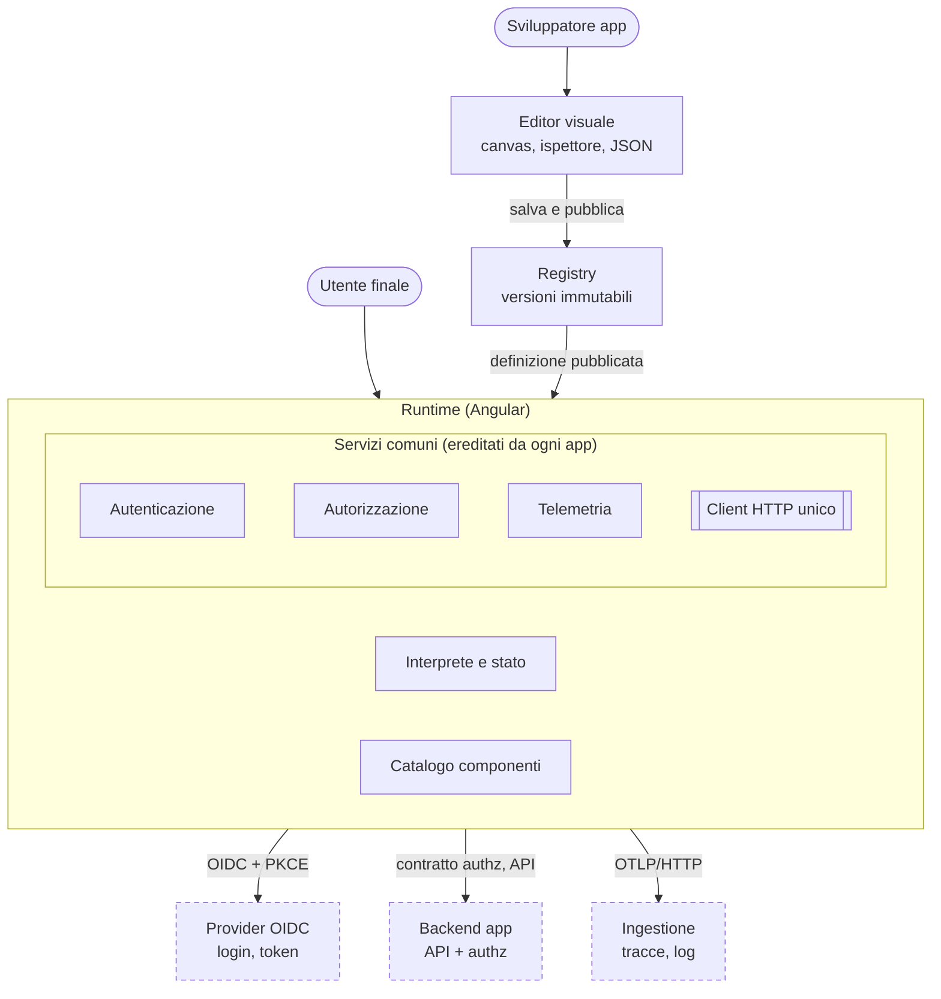
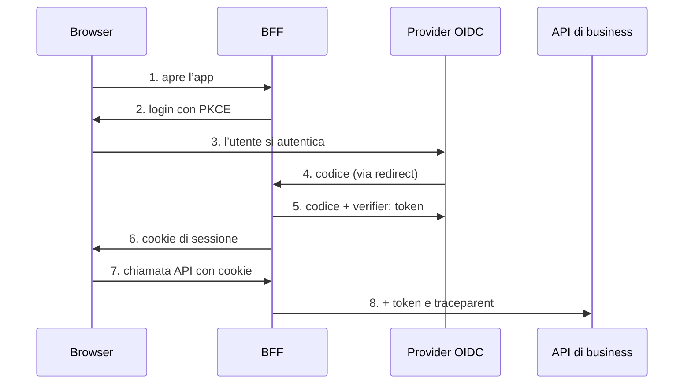

# Piattaforma LowCode — Architettura

Simone Ramaccini · 7 ottobre 2026

## 1. Sintesi e principi architetturali

La piattaforma è fatta di tre parti (editor, registry, runtime) che ruotano attorno a un unico contratto: il linguaggio JSON con il suo JSON Schema. Tutto il resto, dai servizi di sicurezza alla telemetria, è costruito una volta nel runtime e ereditato da ogni applicazione.

| Principio | Cosa significa | Conseguenza pratica |
| --- | --- | --- |
| Il JSON è l'unica fonte di verità | Editor e runtime leggono e scrivono lo stesso documento | Nessun formato interno dell'editor; si può passare dal visuale al testo senza perdite |
| Si interpreta, non si genera codice | Il runtime legge il JSON a tempo di esecuzione | Modifiche visibili subito, anteprima fedele; la sicurezza si ottiene con validazione prima della pubblicazione |
| Il frontend non è mai il punto di enforcement | Nascondere è esperienza d'uso, non protezione | Il backend rifiuta e filtra sempre; il runtime gestisce uniformemente i 403 |
| Standard aperti ovunque | OIDC, OpenAPI, OpenTelemetry, W3C Trace Context | Nessun protocollo proprietario; integrazione con strumenti esistenti |
| Le regole trasversali si scrivono una volta | Un solo client HTTP, un solo servizio di autorizzazione, una sola telemetria | L'autore dell'app non può dimenticarsi di token, tracciamento o gestione errori |
| Via di fuga controllata | Componenti personalizzati registrabili con un contratto | I casi non previsti non obbligano ad abbandonare la piattaforma |
| Governabile per costruzione | JSON versionabile, confrontabile, revisionabile | Storico, diff, revisione e ripristino come per il codice |

**Confine del prodotto.** Lato backend la piattaforma consegna solo le interfacce REST (specifiche OpenAPI per autorizzazione, telemetria e registry) e una reference implementation che le realizza. La reference implementation serve a dimostrare i contratti e a fare da banco di prova: non è un servizio di produzione. Ogni implementazione del cliente deve superare gli stessi test di conformità (proposta: un kit di test di contratto fornito con la piattaforma).

## 2. Vista d'insieme

La piattaforma ha tre parti proprie (editor, registry, runtime), un livello di servizi comuni dentro il runtime e due contratti REST che i backend dei clienti implementano. Il provider di identità e il sistema di osservabilità sono esterni e standard.

*Un solo client HTTP applica sicurezza e tracciamento a ogni chiamata. Tratteggiato = esterno alla piattaforma.*

Il runtime è l'unico componente a contatto con l'utente finale; editor e registry servono a chi costruisce le applicazioni, e tutto ciò che esce dal runtime passa dal client HTTP unico.

## 3. Linguaggio di definizione e JSON Schema

Il linguaggio ha tre livelli, così che il nucleo resti piccolo e stabile mentre il catalogo cresce.

| Livello | Contenuto | Chi lo evolve |
| --- | --- | --- |
| Nucleo | Applicazione, schermata, nodo componente, data source, azione, espressione, stato | Team della piattaforma, con cambi rari e controllati |
| Catalogo componenti | Un JSON Schema per ogni tipo di componente: proprietà, eventi, punti di inserimento | Team della piattaforma e, per i componenti personalizzati, i team applicativi |
| Estensioni | Componenti, azioni e funzioni di espressione aggiunti da pacchetti | Chiunque, tramite un contratto di registrazione |

**Il JSON Schema come motore dell'editor.** Poiché ogni componente descrive le proprie proprietà con uno schema, l'editor genera da solo il pannello delle proprietà e la validazione: aggiungere un componente non richiede modifiche all'editor.

**Versionamento.** Ogni documento riporta `schemaVersion`. Le migrazioni sono funzioni pure "versione N verso N+1", applicate dal registry alla pubblicazione e dal runtime al caricamento se serve. Si propone che il runtime supporti la versione corrente e la precedente, con le altre migrate automaticamente.

**Validazione in tre punti.** Nell'editor mentre si scrive, alla pubblicazione nel registry (blocca documenti non validi) e al caricamento nel runtime (difesa in profondità).

**Riuso.** Frammenti riutilizzabili (per esempio un blocco di filtri comune) referenziati con `$ref`, per evitare duplicazioni tra schermate.

**Binding ed espressioni.** I valori dinamici usano la sintassi `{{ ... }}`; tutto ciò che è tra doppie graffe è un'espressione del linguaggio scelto nella sezione 5.

**Documenti collegati: tema e menu.** Oltre alle schermate esistono due documenti con schema proprio. Il *tema* contiene solo design token (colori, font, raggio, spaziature, altezza dei controlli, densità compatta o comoda), validati con un pattern restrittivo per impedire l'iniezione di CSS; il runtime li applica come variabili CSS `--lc-*`, quindi i componenti non contengono colori propri. Un ponte (theme-bridge, nella libreria components) traduce poi i colori primario, successo ed errore nelle variabili --ant-\* di NG-ZORRO, con la scala di tonalità calcolata, e per i temi scuri carica lo stylesheet scuro della libreria; così il cambio di tema a runtime vale anche per i suoi componenti. La *navigazione* elenca i casi d'uso, cioè le aree funzionali con un menu ciascuna, fino a tre livelli fissi imposti dallo schema (gruppo, sottogruppo, voce); una voce punta a una schermata con parametri opzionali, può avere `requires` (permesso) e `visibleIf` (CEL). Un gruppo o un caso d'uso senza voci visibili non viene mostrato.

**Guscio dell'applicazione, guidato dal tema.** L'aspetto generale segue lo stile di Ant Design Pro: a sinistra la barra laterale a tutta altezza, con il logo in cima, sopra il selettore del caso d'uso e il menu a più livelli, comprimibile a sole icone (i gruppi si aprono in un popup) con un pulsante tondo sul suo bordo; in alto la barra con le scelte della demo e, a destra, il menu utente (avatar, nome e voci dell'applicazione, con l'uscita sempre come ultima voce); al centro l'intestazione di pagina (briciole di pane ricavate dal menu, titolo, descrizione facoltativa) e il contenuto in card su sfondo grigio chiaro. Nulla di tutto questo è fisso nel codice: il documento tema ha un gruppo facoltativo `layout` con i colori, il tono (chiaro o scuro) e la larghezza della barra laterale, i colori e l'altezza della barra superiore, i colori dell'intestazione di pagina e il margine del contenuto, che diventano variabili `--lc-sider-*`, `--lc-header-*`, `--lc-page-header-*` e `--lc-content-padding`. Se mancano, si ricavano dai colori base (barra laterale chiara come in Ant Design Pro). Il repository fornisce tre temi: chiaro, classico (barra laterale blu scuro) e scuro. Le voci lunghe del menu vanno a capo invece di essere troncate.

## 4. Runtime

Il runtime è un'applicazione Angular (versione corrente, componenti standalone e signals) che interpreta il JSON. Ha moduli con responsabilità separate, così che ciascuno sia sostituibile e testabile da solo.

| Modulo | Responsabilità |
| --- | --- |
| Loader | Scarica la definizione dal registry, la valida, la migra se necessario |
| Interprete | Trasforma l'albero dei nodi JSON in componenti Angular cercandoli nel catalogo per tipo |
| Stato | Mantiene lo stato di schermata (filtri, selezione, valori del form) in uno store reattivo; espone `state` alle espressioni |
| Data layer | Esegue i data source dichiarati, con cache, invalidazione e paginazione; non conosce l'interfaccia |
| Motore di azioni | Esegue le sequenze di passi, con gestione degli errori e annullamento |
| Valutatore di espressioni | Esegue le espressioni nel linguaggio scelto, in ambiente isolato (sezione 5) |
| Servizi comuni | Autenticazione, autorizzazione, telemetria e client HTTP, descritti nelle sezioni 6, 7 e 8 |
| Catalogo componenti | Registro dei componenti disponibili, ciascuno con il proprio schema e le proprietà dichiarate. I componenti standard sono costruiti sulla libreria grafica NG-ZORRO (ADR-11) |

**Il client HTTP unico è il punto chiave.** Ogni chiamata, di business o di servizio, passa da lì: aggiunge il token (o usa il cookie di sessione in modalità BFF), propaga `traceparent`, gestisce 401 e 403 in modo uniforme, normalizza gli errori e applica la redazione dei dati sensibili ai log. Un'applicazione definita in JSON non ha modo di aggirarlo.

**Isolamento tra le schermate.** Ogni schermata ha il proprio stato e il proprio contesto di espressioni: le schermate comunicano solo tramite parametri di navigazione dichiarati, non condividendo variabili implicite.

**Indirizzi e struttura del codice.** Ogni schermata ha un URL del tipo `/<casoD'uso>/<schermata>?parametri`, gestito da Angular Router: Indietro, preferiti e link condivisi funzionano. Il codice è diviso in librerie: `schema` (JSON Schema e tipi), `expressions` (CEL), `core` (interprete e porte astratte: `Authorization`, `UserProvider`, `DataClient`, `ScreenNavigator`, `Notifier`, `RuntimeDiagnostics`), `components` (catalogo, menu laterale `lc-sidebar` e ponte verso NG-ZORRO) e l'app `runtime`. Il core non conosce né il router né il backend, e della libreria grafica usa solo il guscio della schermata (titolo e messaggio di rifiuto): li ottiene dalle porte, sostituibili in test e nella demo. `Authorization` deve essere basata su signal, così l'interfaccia si aggiorna quando cambiano i permessi; ogni condizione che fallisce nega (fail-closed) e l'errore viene segnalato a `RuntimeDiagnostics` in modo differito, mai durante il rendering.

**Aggiornamenti di ottobre 2026.** Due nuove porte: `Confirmation` (passo `confirm`) e `FormDialog` (passo `dialog`, una finestra con un form); senza implementazione i due passi non procedono. `DataRequest` può portare un `file`: il client HTTP invia allora un corpo multipart (`FormData`), fino a 100 MB, al posto del base64 nel JSON. Un data source GET si ricarica da solo solo quando cambia la richiesta risolta (URL e parametri), non a ogni cambiamento dello stato; `ScreenRuntime.query` esegue un data source senza toccare il suo stato condiviso (lo usano i campi lookup). Il catalogo dei componenti, con specifiche e limiti, è `docs/catalogo-componenti.md` nel repository.

## 5. Linguaggio delle espressioni

Si propone un linguaggio leggero, deterministico e tipizzato, senza motori di regole pesanti. Le espressioni servono a pochi scopi: condizioni (visibilità, abilitazione), valori calcolati e validazioni.

**Requisiti.** Nessun accesso a rete, DOM o codice arbitrario; esecuzione sempre terminante (niente cicli illimitati); errori leggibili con posizione; verificabile in fase di pubblicazione; implementazione disponibile in JavaScript per il runtime e, preferibilmente, in Java per condividere le stesse regole con il backend.

| Candidato | Punti di forza | Limiti per questo uso |
| --- | --- | --- |
| CEL (Common Expression Language) | Pensato per valutazioni sicure e limitate nel tempo; tipizzato, quindi controllabile prima dell'esecuzione; implementazioni anche in Java | Meno adatto a trasformazioni complesse di strutture JSON |
| JSONata | Molto espressivo per interrogare e trasformare JSON; ottimo per mappare le risposte delle API | Linguaggio più ampio, quindi più difficile da isolare e da controllare staticamente |
| JSONLogic | Regole stesse in JSON, molto semplice da isolare | Poco leggibile appena le regole crescono; limitato |

**Proposta.** Usare CEL per tutti i predicati (visibilità, abilitazione, validazione), con le funzioni predefinite `can`, `user` e `state`. Per la trasformazione delle risposte dei data source partire con un mapping dichiarativo (rinomina, selezione, conversione di tipo) e introdurre JSONata solo se un caso reale lo richiede, per non avere due linguaggi fin dall'inizio.

**Validato con una prova di fattibilità (superata)**: l'implementazione JavaScript scelta (cel-js) non usa eval, valuta le espressioni in modo deterministico, permette la verifica statica nell'editor e funziona con la regola "se l'espressione fallisce, la condizione è falsa". Resta da misurare il comportamento su liste molto grandi.

## 6. Autenticazione

Il flusso raccomandato usa il pattern BFF (Backend For Frontend): un piccolo servizio lato server esegue il login OAuth2 con PKCE presso il provider, conserva i token e dà al browser solo un cookie di sessione. Il browser non vede mai i token.

*Il browser riceve solo un cookie di sessione: i token restano nel BFF.*

Il BFF è l'unico a parlare con il provider e a custodire i token; al browser arriva solo il cookie di sessione.

Sono due le modalità, scelte per applicazione: **BFF** (raccomandata per contesti regolati) e **SPA con token in memoria** (più semplice, più esposta). In entrambe, nessuna schermata è mostrata prima dell'autenticazione e il JSON non contiene mai segreti. Rinnovo e logout sono gestiti dal servizio di autenticazione del runtime, con ritorno pulito alla schermata di accesso alla scadenza; in modalità BFF il servizio inoltra le chiamate alle API aggiungendo il token e può applicare l'elenco degli host consentiti.

## 7. Autorizzazione

Il backend dell'applicazione implementa un contratto REST pubblicato dalla piattaforma come specifica OpenAPI. Il runtime lo consuma attraverso il servizio di autorizzazione, che è l'unico punto da cui le espressioni leggono i permessi.

| Endpoint (proposta) | Scopo | Note |
| --- | --- | --- |
| `GET /authz/capabilities?app={id}` | Restituisce l'elenco dei permessi dell'utente per l'applicazione, con una versione dell'insieme | Chiamato dopo il login e quando cambia la versione |
| `POST /authz/check` | Verifica a lotti di coppie azione/risorsa | Per i casi con troppe combinazioni per un elenco globale |
| Campo `_perm` nei dati | Permessi per singola riga restituiti insieme alla risorsa, per esempio `{ "update": true, "delete": false }` | Letto dalle espressioni come `row._perm.update` |

**Nomi dei permessi.** Convenzione a tre parti esatte `dominio.risorsa.azione` (per esempio `ordini.iban.scrivi`), così che il livello di granularità sia leggibile nel nome e il campo specifico non richieda un meccanismo a parte.

**Cache e aggiornamento.** Le capacità sono tenute in memoria dal runtime. Il backend include in ogni risposta un'intestazione con la versione corrente dei permessi dell'utente; se il runtime nota una versione diversa da quella in cache, ricarica le capacità. Questo evita sia richieste continue sia interfacce che restano obsolete.

**Gestione del 403.** Il client HTTP intercetta ogni 403, mostra un messaggio uniforme, richiede un aggiornamento dei permessi e rivaluta l'interfaccia.

**Due difese complementari.** Il frontend nasconde e disabilita secondo i permessi; il backend verifica sempre la richiesta e filtra i dati in uscita, quindi anche un JSON manomesso o una chiamata diretta non ottengono ciò che non spetta.

**Autorizzazione di editor e registry.** Pubblicare o modificare un'applicazione è a sua volta un permesso, verificato con lo stesso contratto.

## 8. Telemetria e audit

Il runtime usa l'SDK OpenTelemetry per browser. Le tracce partono dal runtime, seguono la chiamata REST grazie all'intestazione `traceparent` e continuano nei servizi di backend, così una singola azione dell'utente è ricostruibile da un capo all'altro.

| Segnale | Origine | Percorso |
| --- | --- | --- |
| Tracce | Schermata aperta, azione eseguita, chiamata API | Runtime, poi endpoint REST di ingestione (OTLP/HTTP), poi collector e sistema di osservabilità |
| Log | Errori, avvisi, eventi applicativi con livello configurabile | Stesso percorso, raggruppati e inviati anche alla chiusura della pagina |
| Contesto per l'audit | Schermata, azione, identificativo di correlazione | Intestazioni delle chiamate REST (`traceparent` e baggage W3C), registrate dal backend |

**Endpoint di ingestione.** Il browser non scrive direttamente su un collector: passa da un endpoint REST dello stesso dominio dell'applicazione, autenticato con la sessione dell'utente, con limiti di dimensione e di frequenza. Qui si applicano anche controlli e una seconda redazione dei dati sensibili.

**Redazione a due livelli.** I campi marcati `sensitive` nel JSON sono esclusi dal runtime all'origine; l'endpoint di ingestione applica poi regole aggiuntive (per esempio schemi riconoscibili come codici fiscali o IBAN). Difesa in profondità: un errore in un livello non diventa una fuga di dati.

**Campionamento.** Configurabile per applicazione e ambiente; gli errori sono sempre conservati.

**Audit.** L'audit trail è scritto dal backend al momento in cui l'operazione avviene, in un archivio con immutabilità e conservazione definite dal cliente. Il frontend non scrive mai direttamente l'audit, perché non è un'origine affidabile. Il collegamento tra traccia tecnica e audit è l'identificativo di correlazione, che permette di passare da una riga di audit alla traccia completa.

## 9. Architettura dell'editor visuale

L'editor è un'applicazione Angular che gestisce un **modello del documento** (il JSON) e ne offre più viste sincronizzate. La cronologia conserva versioni immutabili del documento (ADR-09): da qui derivano annulla/ripeti; diff tra versioni, come operazioni JSON Patch (RFC 6902) ricavate per differenza, e nelle versioni successive, i meccanismi di lock per l'editing.

| Parte | Ruolo |
| --- | --- |
| Modello del documento | Contiene il JSON corrente e la cronologia delle operazioni |
| Palette | Elenco dei componenti disponibili, letto dal catalogo |
| Canvas | Vista a blocchi della schermata; trascinando si generano operazioni sul modello |
| Ispettore delle proprietà | Pannello generato dal JSON Schema del componente selezionato |
| Editor di testo | Vista JSON con validazione contro lo schema e suggerimenti |
| Diagnostica | Elenco degli errori di validazione e dei controlli sulle espressioni |
| Anteprima | Il runtime reale, ospitato in un iframe isolato e alimentato dal modello |
| Simulatore di permessi | Fornisce all'anteprima un utente e permessi fittizi per verificare visibilità e blocchi |
| Client del registry | Salvataggio, versioni, confronto e pubblicazione |

**Perché un iframe per l'anteprima.** Isola stili e codice dell'editor da quello dell'applicazione, riproduce fedelmente la produzione e permette di sostituire autenticazione e API con simulazioni senza toccare il runtime. L'editor e l'anteprima comunicano tramite messaggi con formato definito.

**Perché il pannello generato dallo schema.** Aggiungere un componente al catalogo con il suo schema rende disponibili automaticamente palette, ispettore e validazione, senza modificare l'editor.

**Approccio incrementale.** La prima versione può limitarsi a editor di testo con validazione e anteprima dal vivo, che già rende utilizzabile la piattaforma; canvas e trascinamento si aggiungono sullo stesso modello.

**Stato al 13 ottobre 2026.** Editor realizzato (`frontend/projects/editor`, dettagli in `docs/editor.md`) per schermate, navigazione e temi: palette, struttura con trascinamento, ispettore e validazione generati dagli schemi JSON, vista JSON, diagnostica, aiuto alle espressioni, testi e traduzioni, simulatore di permessi. Le anteprime (schermata, menu, tema) girano in un iframe isolato con l'applicazione avviata in modalità anteprima e comunicano con l'editor tramite messaggi definiti (stato verso l'anteprima; pronto, selezione ed eventi del registro verso l'editor), solo tra finestre della stessa origine. Decisioni del 13 ottobre: ADR-08 accettata, ADR-09 modificata (versioni immutabili), registry a **documenti separati** — una schermata, la navigazione e ogni tema sono documenti distinti, ognuno con le proprie versioni e pubblicazioni; il contratto del registry va adeguato e il client del registry nell'editor resta da fare.

## 10. Registry, versionamento e pubblicazione

Il registry è un servizio REST che conserva le definizioni delle applicazioni. Ogni versione è **immutabile** e identificata da un hash del contenuto; "pubblicare" significa far puntare un ambiente a una versione, non sovrascriverla.

Anche *temi* e *navigazione* sono artefatti del registro, con le stesse regole di immutabilità, versione e ripristino delle schermate. Uno stesso tema può essere associato a più applicazioni; il menu può cambiare senza ripubblicare le schermate.

| Stato | Significato | Chi può passare allo stato successivo |
| --- | --- | --- |
| Bozza | In modifica nell'editor, visibile solo all'autore | Autore, salvando una versione |
| In revisione | Versione congelata in attesa di approvazione | Revisore con il permesso dedicato |
| Pubblicata | Versione servita agli utenti di un ambiente | Chi ha il permesso di pubblicazione |
| Ritirata | Non più servita, ma conservata nello storico | Chi ha il permesso di pubblicazione |

**Ambienti.** Sviluppo, collaudo e produzione puntano a versioni diverse della stessa applicazione; la promozione da un ambiente al successivo è un'operazione esplicita e tracciata.

**Ripristino.** Tornare a una versione precedente significa ripubblicarla: non serve ricostruire nulla.

**Distribuzione al runtime.** Il runtime richiede la versione pubblicata per applicazione e ambiente, con cache HTTP basata su ETag. L'hash del contenuto permette di verificarne l'integrità.

**Compatibilità con Git.** Le definizioni sono file di testo: il registry le espone anche come esportazione/importazione, così chi vuole può tenerle in un repository e integrarle nella propria integrazione continua.

**Multi-tenant.** Ogni applicazione appartiene a un tenant; permessi e visibilità sono isolati per tenant. Il modello esatto è un punto aperto (sezione 13).

## 11. Sicurezza

In una piattaforma che interpreta documenti, il documento stesso è input non fidato: le difese si basano su questo presupposto.

**Validazione nel browser e CSP.** Ajv compila gli schemi con `new Function`, quindi la validazione lato browser richiede `unsafe-eval` nella Content Security Policy, che in produzione non è accettabile. Le strade sono: compilare gli schemi in anticipo (Ajv standalone), oppure validare solo alla pubblicazione e nell'editor. CEL (cel-js) non usa eval. Le risposte del server non vengono mai mostrate all'utente: il runtime mostra un messaggio generico.

| Minaccia | Contromisura |
| --- | --- |
| JSON manomesso o espressione malevola | Validazione contro lo schema in tre punti; espressioni in ambiente isolato; nessun uso di `eval` o equivalenti |
| XSS attraverso testi o dati | Valori sempre inseriti come testo, mai come HTML; sanitizzazione dove l'HTML è inevitabile; politica CSP restrittiva |
| Furto di token | Modalità BFF con cookie HttpOnly, Secure e SameSite; in modalità SPA token solo in memoria, mai in localStorage |
| CSRF in modalità BFF | Cookie SameSite e token anti-CSRF per le richieste che modificano dati |
| Elevazione di privilegi dal frontend | Il backend verifica ogni richiesta e filtra i dati: il JSON non può concedere nulla |
| Chiamate verso host arbitrari dichiarate nel JSON | Elenco di host consentiti per ambiente, applicato dal client HTTP o dal BFF |
| Componenti personalizzati dannosi | Registrazione controllata e revisionata; nessun caricamento di codice da URL arbitrari; integrità verificata |
| Fuga di dati personali nei log | Redazione a due livelli (runtime e ingestione) |
| Pubblicazione non autorizzata | Permesso dedicato e fase di revisione; ogni pubblicazione è tracciata nell'audit |
| Dipendenze vulnerabili | Analisi delle dipendenze e inventario del software (SBOM) nella pipeline |

## 12. Decisioni architetturali

Ogni decisione riporta le alternative considerate e lo stato. "Proposta" significa da confermare; "Da validare" richiede una prova di fattibilità.

| ID | Decisione | Alternative scartate | Motivo | Stato |
| --- | --- | --- | --- | --- |
| ADR-01 | Lato backend la piattaforma fornisce solo interfacce REST e una reference implementation | Fornire servizi di backend completi di produzione | Mantiene il prodotto focalizzato; i backend dipendono dal contesto del cliente | Accettata |
| ADR-02 | Il runtime interpreta il JSON | Generare codice Angular dal JSON | Modifiche immediate e anteprima fedele; la sicurezza si recupera con la validazione | Proposta |
| ADR-03 | Token gestiti con pattern BFF, con modalità SPA come opzione | Solo token nel browser | Più sicuro per contesti regolati | Proposta |
| ADR-04 | CEL per i predicati | JSONata, JSONLogic | Sicuro, tipizzato, verificabile; stesse regole anche lato Java | Accettata |
| ADR-05 | OpenTelemetry con ingestione OTLP/HTTP | Protocollo proprietario di log | Standard, strumenti esistenti, propagazione verso il backend | Proposta |
| ADR-06 | Audit scritto dal backend | Audit inviato dal frontend | Il frontend non è un'origine affidabile | Proposta |
| ADR-07 | JSON Schema per ogni componente del catalogo | Descrittori in formato proprio | L'editor genera pannelli e validazione automaticamente | Proposta |
| ADR-08 | Anteprima dell'editor in iframe isolato | Anteprima nella stessa pagina | Isolamento e fedeltà alla produzione | Accettata (13 ottobre 2026) |
| ADR-09 | Cronologia dell'editor come versioni immutabili del documento | Modifiche come operazioni JSON Patch (proposta iniziale) | Annulla/ripeti semplice e affidabile; diff e operazioni JSON Patch si ricavano per differenza tra versioni quando servono (confronti, lock) | Accettata, modificata (13 ottobre 2026) |
| ADR-10 | Versioni immutabili nel registry, pubblicazione come puntatore | Sovrascrittura della versione corrente | Ripristino semplice, storico affidabile | Proposta |
| ADR-11 | Libreria grafica NG-ZORRO (Ant Design per Angular) per tutti i componenti standard | Solo Angular CDK con componenti scritti in casa; Angular Material; PrimeNG | Tabelle, form, schede, menu, finestre e selettori già completi di tastiera, focus e accessibilità; aderenza a Angular 22 con signals e senza zone; il tema resta un documento di token, tradotto nelle variabili della libreria da un ponte. Si accetta che l'aspetto sia quello di Ant Design e che le stringhe passate a modali e messaggi siano interpretate come HTML (si mitiga passando testo reso innocuo) | Accettata |

## 13. Rischi e punti aperti

| Rischio | Perché conta | Mitigazione |
| --- | --- | --- |
| Il linguaggio cresce fino a diventare un linguaggio di programmazione | Perde semplicità e governabilità, e diventa difficile da isolare | Criteri di ammissione per ogni nuova funzione o azione; la logica complessa resta nel backend |
| Evoluzione dello schema che rompe applicazioni esistenti | Le app dei clienti smettono di funzionare | Versionamento esplicito, migrazioni automatiche e test di compatibilità su un insieme di applicazioni di riferimento |
| Prestazioni dell'interprete su schermate molto grandi | Interfacce lente nei gestionali con molte righe | Paginazione lato server, virtualizzazione delle liste, caricamento differito |
| Complessità dell'editor visuale | Rischio di ritardo e di funzioni incomplete | Consegna per fasi: testo e anteprima prima, canvas dopo |
| Qualità dell'implementazione JavaScript di CEL | Il motore delle espressioni è critico per sicurezza e prestazioni | Prova di fattibilità prima della scelta definitiva; alternativa pronta |
| Permessi non aggiornati nell'interfaccia | L'utente vede azioni non più consentite | Versione dei permessi nelle risposte e gestione uniforme del 403 |
| Dipendenza da un solo provider di identità | Limita l'adozione | Standard OIDC, nessuna logica specifica del provider nel runtime |
| La libreria grafica cambia in modo incompatibile tra versioni maggiori | Tutti i componenti standard dipendono dal suo aspetto e dalle sue interfacce | Versione fissata nel repository e aggiornata con un processo regolare; l'uso resta confinato alla libreria components (più il guscio della schermata nel core); i test dei componenti coprono i comportamenti attesi |

**Punti aperti da chiudere**, in ordine di impatto: modello multi-tenant e degli ambienti; forma di distribuzione del runtime (applicazione autonoma o componente incorporabile in un'altra shell); formato esatto del contratto di autorizzazione per le liste con molti permessi per riga; politica di conservazione e immutabilità dell'audit; obiettivi quantitativi di prestazioni.
