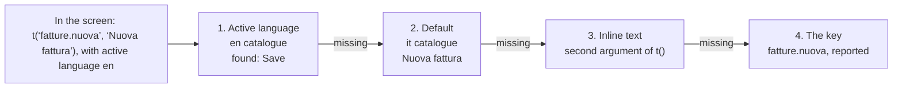

# Dynamic texts and i18n: overview of the options

Simone Ramaccini · 9 October 2026

## Summary

Texts in the JSON are already dynamic thanks to `{{ … }}` expressions, but they cannot be translated. The proposal is to add a message catalogue per language, referenced by a key (`{{ t('fatture.salva') }}`), with the text written in the JSON as a fallback. This way a screen works even without translations and the catalogue can grow little by little.

The **optional tooltip** is already implemented (commit `f3f24bd`): every node can have `"tooltip": "…"`, and the same goes for actions, fields and columns. It is plain text only (never HTML) and accepts `{{ }}` expressions, so it follows the choice made below straight away.

**What we have today**

- Button and tab labels, titles, texts, alerts and tooltips are strings evaluated with `{{ … }}` (CEL) against the state, the user, the row or the form.
- The language is fixed: the NG-ZORRO locale is Italian and the runtime's own strings ("Tutti", "Conferma", "Annulla", "Caricamento…", "Nessun risultato.") are written in the code.
- Numbers, currencies and dates are formatted with `Intl`, but with a locale that cannot be configured.

**What is missing**

- An active language per session (chosen by the user or by the profile).
- A place to keep translations and a way to reference them from the JSON.
- Plurals, placeholders and formats that change with the language.
- The runtime's own strings, made translatable too.

## Which texts need to become dynamic

Texts are not all alike: they differ in who writes them, where they live and whether they depend on the language, on data or on both. Telling them apart helps choose the right tool for each.

| Family | Examples | Who writes it | Depends on | Today |
| --- | --- | --- | --- | --- |
| Screen texts | `label` of buttons, columns, fields; `title`; `text`; `tooltip`; `toast` and `confirm` messages | The screen designer (editor) | Language and sometimes data | String with `{{ }}`, in one language only |
| Validation messages | `validate.message` | The screen designer | Language and entered values | Fixed string |
| Navigation and theme | `label` of menu items and use cases, `brand` | The application designer | Language | Fixed string |
| Runtime strings | "Tutti", "Conferma", "Annulla", "Caricamento…", "Nessun risultato." | Us (the platform) | Language | Written in the code, in Italian |
| Texts from the back end | Errors and messages returned by the APIs, status values (e.g. `inviato`) | The external service | Language of the request | Shown as they arrive |
| Formats | Currencies, dates, numbers, percentages | The runtime with `Intl` | Language and region | Fixed locale |

A useful distinction follows: the first three groups are *content* of the screen and belong in the JSON files or their catalogues; the fourth is *product*, and we handle it with catalogues shipped by the library; the last two are not translated by hand but governed by the session language.

## Dynamic texts: the options

Making a text dynamic means making its content depend on data, state or user. The options are not mutually exclusive: they are four levels that can be combined, from the simplest to the most ambitious.

**A1. Inline `{{ }}` expressions (already there).** The text contains CEL fragments evaluated against the screen context.

```json
{ "type": "button", "label": "Approva {{row.numero}}",
  "tooltip": "Solo {{user.username}} può approvare ordini sopra {{state.soglia}} €" }
```

It reads at a glance and needs nothing new. The limit is that presentation logic (plurals, formats, capitalisation) ends up inside the string and has to be rewritten in every screen.

**A2. Presentation functions for expressions.** We add a small set of safe, side-effect-free functions to CEL: `fmt.currency(v, 'EUR')`, `fmt.date(v)`, `fmt.number(v)`, `plural(n, 'una fattura', '{n} fatture')`, `upper(s)`, `truncate(s, 20)`.

```json
{ "type": "text", "text": "Totale: {{ fmt.currency(state.totale, 'EUR') }} ({{ plural(size(state.righe), 'una riga', '{n} righe') }})" }
```

It is the smallest change with the biggest return: it takes logic out of the texts and prepares i18n, because these functions read the active language. It costs little and stays within the safe perimeter of the language (no network or DOM access).

**A3. Texts coming from a data source.** The label points to a value loaded from an API or a file, for example a content service that lets a business user change a text without republishing the screen.

```json
"dataSources": { "testi": { "type": "rest", "method": "GET", "url": "/api/contenuti/fatture" } },
"components": [{ "type": "button", "label": "{{ state.testi.salva }}", "onClick": [] }]
```

It is the most flexible form, but it moves the truth about texts outside the JSON: the editor cannot show the preview or check that the key exists, and a network error leaves the button without a label.

**A4. Dynamic non-text properties.** Today only strings and conditions (`visibleIf`, `enabledIf`…) are dynamic. For the tone, icon, placeholder or format of a column the rule can be extended: every string property accepts `{{ }}`.

```json
{ "type": "button", "label": "Elimina", "tone": "{{ row.stato == 'bozza' ? 'danger' : 'neutral' }}" }
```

It requires declaring in the schema which properties are "dynamic" (otherwise the editor does not know what to validate). Useful, but not urgent.

## i18n: the options

i18n needs three things: an **active language** (per session), **translated texts** and **formats** that follow it. The options below are mostly about the second point, that is where translations live and how the JSON references them.



*A text is looked up in four places and the first one that exists wins. Here the key exists in English: the lookup stops at the first step and shows Save.*

The fallback chain applies to every key-based option (B2, B3, B4): without a translation the text does not disappear, it falls through to the next step.

**B1. Multilingual text directly in the JSON.** Every string becomes, when needed, an object with one entry per language.

```json
{ "type": "button", "label": { "it": "Salva", "en": "Save" },
  "tooltip": { "it": "Salva la fattura", "en": "Save the invoice" } }
```

Getting started is immediate and whoever reads the JSON sees all languages together. With more than two languages, though, the file swells, the same words are repeated in every screen, and a translator has to open and edit the screens.

**B2. Catalogue inside each screen.** The screen has a `messages` block with the languages, and components use keys.

```json
{ "screen": "fatture-elenco",
  "messages": { "it": { "salva": "Salva" }, "en": { "salva": "Save" } },
  "components": [{ "type": "button", "label": "{{ t('salva') }}" }] }
```

Screens stay self-contained and are published as a single file. But common words ("Salva", "Annulla", "Elimina") are duplicated everywhere and translations have no single place where they can be reviewed.

**B3. Application catalogue with keys (recommended as the base).** Translations live in separate files per language, with keys grouped by domain; screens reference them with `t('key')`. The text written in the JSON remains as a fallback when the key is missing.

```json
// i18n/it.json                          // i18n/en.json
{ "comune.salva": "Salva",                { "comune.salva": "Save",
  "fatture.nuova": "Nuova fattura" }        "fatture.nuova": "New invoice" }

// in the screen
{ "type": "button", "label": "{{ t('fatture.nuova', 'Nuova fattura') }}" }
```

Translation happens in one place, common words are reused, files can be exchanged with translation tools (ICU, XLIFF, PO formats) and the editor can list missing keys. The price is one more file to ship and to keep aligned with the screens.

**B4. Catalogue served at run time by a service.** Like B3, but the catalogue is not a file in the package: the runtime downloads it at start-up (or when the language changes) from an API, behind which there can be a professional translation system.

```json
GET /api/i18n/en?app=gestionale&v=42
{ "comune.salva": "Save", "fatture.nuova": "New invoice" }
```

It allows fixing a translation without releasing anything and having translators who never touch the code. It does, however, require one more service, a versioned cache and a plan for when the API does not respond (B3's inline fallback helps with that too).

**B5. Angular's native i18n (`$localize`, XLIFF at build time).** We leave it out: it only translates texts present in the compiled code, whereas our texts live in JSON loaded at run time, and it produces one application per language. It does not fit a platform where the screen is data.

B3 and B4 combine well: the catalogue starts as a file (B3) and the same interface, `t()`, can later read it from a service (B4) without touching the screens. That is why B3 is the natural starting point.

## Cross-cutting aspects

Whatever option is chosen, some common rules remain to be decided. For each one I give the choice I recommend.

| Topic | The problem | Recommended choice |
| --- | --- | --- |
| Active language | Where it comes from and how it changes | A single session value (`locale`), available in expressions as `user.locale`; order: the user's choice, profile, browser language, the app's default language. Changing language updates everything without reloading. |
| Fallback | What to show if the translation is missing | Fixed chain: active language, default language, inline text, the key itself. In development a missing key is reported in the diagnostics. |
| Plurals and placeholders | "1 fattura" / "3 fatture", "Ciao {nome}" | Messages in ICU format (`{n, plural, one {# fattura} other {# fatture}}`): it is the standard of translation tools and handles languages with several plural forms. |
| Formats | Currencies, dates, numbers, percentages | The runtime uses `Intl` with the active language; the currency stays a property of the column (`currency`), the language only decides the form. |
| Component library | NG-ZORRO locale (calendars, pagination, "Nessun dato") | Changes together with the active language; today it is fixed to Italian. |
| Runtime strings | "Tutti", "Conferma", "Annulla", "Caricamento…" | They go into a library catalogue (it and en to begin with), with `lc.*` keys, which the application can override. |
| Texts coming from the APIs | Errors and status values in the server's language | The runtime sends the active language (`Accept-Language`); fixed values (such as statuses) are translated in the catalogue with a key built from the value (`stato.inviato`). |
| Security | A translation is external input | Always plain text, never HTML, as for tooltips and messages: a wrong or hostile translation cannot inject markup. Placeholders receive values already as text. |
| Writing direction | Arabic, Hebrew (right to left) | Outside the first step; NG-ZORRO supports it, and the theme will need to be able to declare it. |

A detail that saves work: the `t()` function does not change how expressions work, it is just one more function in CEL (like `can()` for permissions). This means that everything that accepts `{{ }}`, tooltips included, becomes translatable with no other change.

## Impact on the visual editor

The editor has not been started yet, so this is the right moment to make the choice: changing the text model later is much more expensive. With the application catalogue (B3) the editor can offer screen authors three concrete aids.

- **Text field with choice**: every label is written as free text or picked as a key from the catalogue; if the key does not exist, the editor offers to create it with the text already typed.
- **Preview in several languages**: a language selector in the editor shows the screen in the chosen language and highlights in yellow the texts without a translation.
- **Check before publishing**: a list of the keys used in the screens but missing from a language, computable with the same script that validates the examples today (`validate:examples`).

For expressions (A2) the editor can add a small assistant: the author just picks "currency" or "date" from a list and the editor writes `fmt.currency(…)`; those who do not write expressions never meet CEL.

**An inconsistency to fix first**: today only some texts go through the expression engine (button and tab labels, titles, texts, alerts, tooltips). The labels of **columns, fields and actions** in tables, forms and filters are shown exactly as written, so they are neither dynamic nor translatable. They are a few places in the code and must be aligned whatever the choice.

## Comparison and recommendation

I recommend starting from A2 plus B3: presentation functions in expressions and an application catalogue with keys, referenced by `t()` with the inline text as fallback. It is the minimum that makes the platform truly multilingual without making screens rigid, and it leaves the road to B4 open.

| Option | Simplicity for the author | Reuse and maintenance | Translators' work | Change without release | Implementation cost |
| --- | --- | --- | --- | --- | --- |
| A1 Inline expressions | High | Low | — | No | Already done |
| A2 `fmt.*`, `plural` functions | High | High | — | No | Low |
| A3 Texts from a data source | Medium | Medium | Outside the platform | Yes | Low |
| A4 Dynamic non-text properties | Medium | Medium | — | No | Medium |
| B1 Inline multilingual | High | Low | Hard (they touch the screens) | No | Low |
| B2 Per-screen catalogue | Medium | Low | Medium | No | Low |
| **B3 Application catalogue** | Medium | **High** | **Good** (standard files) | No (needs a release) | Medium |
| B4 Catalogue from a service | Medium | High | Excellent | **Yes** | High |
| B5 Angular native i18n | — | — | — | No | Not applicable |

**How I would proceed, step by step**

1. **Base**: session language, `t()` function with fallback, the application's `it` and `en` catalogues, `fmt.*` and `plural` functions, NG-ZORRO locale and `Intl` following the language, runtime strings in the `lc.*` catalogue. It includes fixing the labels of columns, fields and actions.
2. **Editor**: text field with key choice, per-language preview, list of missing keys.
3. **Optional, if needed**: catalogue from a service (B4) to fix translations without releasing, and dynamic non-text properties (A4).

**Open questions**

1. Do you confirm the A2 + B3 combination as the base, or do you prefer one of the others?
2. Which languages are needed right away? I suggest Italian and English, with the rest added as plain files.
3. Must the catalogue be editable by non-technical users without a release (hence B4 right away), or is the file in the package enough?
4. May I fix the labels of columns, fields and actions right away, so that they go through the expression engine like all the others?

## Decisions taken and implementation status

A2 + B3 were confirmed, with Italian and English, catalogues as files in the package (no service, so B4 is postponed) and the label fix. Everything is implemented and committed (`0de3522`, `e67dfbe`).

Three departures from what is written above:

- **Function names**: CEL does not accept prefixed functions (`fmt.currency`), so they are called `fmtCurrency`, `fmtNumber` and `fmtDate`. `t()` and `plural()` stay as they were.
- **Parameters of `t()`**: a map with values of different types needs `dyn(...)` around hand-written values, for example `{'n': dyn(1), 'nome': state.nome}`. With values coming from the state it is not needed.
- **Where the language changes**: the active language is a value of the `I18n` service, read in expressions as `user.locale`. The demo has a "Lingua" selector in the top bar.

The menu, the invoice list and the "Lingue e traduzioni" section of the base showcase use keys; the other screens stay in Italian and show the fallback. The key helper in the editor is still to be done, once the editor exists.
