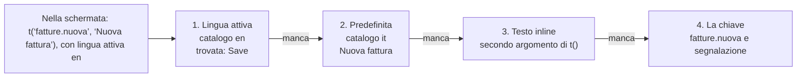

# Testi dinamici e i18n: panoramica delle opzioni

Simone Ramaccini · 9 ottobre 2026

## Sintesi

I testi dei JSON sono già dinamici grazie alle espressioni `{{ … }}`, ma non sono traducibili. La proposta è aggiungere un catalogo di messaggi per lingua, richiamato da una chiave (`{{ t('fatture.salva') }}`), con il testo scritto nel JSON come ripiego. Così una schermata funziona anche senza traduzioni e il catalogo può crescere piano piano.

Il **tooltip opzionale** è già implementato (commit `b0e7c91`): ogni nodo può avere `"tooltip": "…"`, e lo stesso vale per azioni, campi e colonne. È solo testo (mai HTML) e accetta le espressioni `{{ }}`, quindi segue subito la scelta che faremo qui sotto.

**Cosa abbiamo oggi**

- Etichette dei pulsanti e delle schede, titoli, testi, avvisi e tooltip sono stringhe valutate con `{{ … }}` (CEL) sullo stato, l'utente, la riga o il form.
- La lingua è fissa: il locale di NG-ZORRO è italiano e le scritte del runtime ("Tutti", "Conferma", "Annulla", "Caricamento…", "Nessun risultato.") sono scritte nel codice.
- Numeri, valute e date sono formattati con `Intl`, ma con un locale non configurabile.

**Cosa manca**

- Una lingua attiva per sessione (scelta dall'utente o dal profilo).
- Un posto dove tenere le traduzioni e un modo per richiamarle dal JSON.
- Plurali, segnaposto e formati che cambiano con la lingua.
- Le scritte del runtime, rese traducibili anch'esse.

## Quali testi devono diventare dinamici

I testi non sono tutti uguali: cambiano chi li scrive, dove vivono e se dipendono dalla lingua, dai dati o da entrambi. Distinguerli aiuta a scegliere lo strumento giusto per ciascuno.

| Famiglia | Esempi | Chi lo scrive | Dipende da | Oggi |
| --- | --- | --- | --- | --- |
| Testi della schermata | `label` di pulsanti, colonne, campi; `title`; `text`; `tooltip`; messaggi di `toast` e `confirm` | Chi progetta la schermata (editor) | Lingua e talvolta dati | Stringa con `{{ }}`, solo in una lingua |
| Messaggi di validazione | `validate.message` | Chi progetta la schermata | Lingua e valori inseriti | Stringa fissa |
| Navigazione e tema | `label` delle voci di menu, dei casi d'uso, `brand` | Chi progetta l'applicazione | Lingua | Stringa fissa |
| Scritte del runtime | "Tutti", "Conferma", "Annulla", "Caricamento…", "Nessun risultato." | Noi (piattaforma) | Lingua | Scritte nel codice, in italiano |
| Testi dal backend | Errori e messaggi restituiti dalle API, valori degli stati (es. `inviato`) | Il servizio esterno | Lingua della richiesta | Mostrati così come arrivano |
| Formati | Valute, date, numeri, percentuali | Il runtime con `Intl` | Lingua e regione | Locale fisso |

Ne segue una distinzione utile: i primi tre gruppi sono *contenuto* della schermata e vanno nei file JSON o nei loro cataloghi; il quarto è *prodotto*, e lo gestiamo noi con cataloghi forniti dalla libreria; gli ultimi due non si traducono a mano, ma si governano con la lingua della sessione.

## Testi dinamici: le opzioni

Rendere un testo dinamico significa far dipendere il suo contenuto da dati, stato o utente. Le opzioni non si escludono: sono quattro livelli che si possono sommare, dal più semplice al più ambizioso.

**A1. Espressioni inline `{{ }}` (già presente).** Il testo contiene frammenti CEL valutati sul contesto della schermata.

```json
{ "type": "button", "label": "Approva {{row.numero}}",
  "tooltip": "Solo {{user.username}} può approvare ordini sopra {{state.soglia}} €" }
```

Si legge a colpo d'occhio e non richiede nulla di nuovo. Il limite è che la logica di presentazione (plurali, formati, maiuscole) finisce dentro la stringa e va riscritta in ogni schermata.

**A2. Funzioni di presentazione per le espressioni.** Aggiungiamo al CEL un piccolo set di funzioni sicure e senza effetti: `fmt.currency(v, 'EUR')`, `fmt.date(v)`, `fmt.number(v)`, `plural(n, 'una fattura', '{n} fatture')`, `upper(s)`, `truncate(s, 20)`.

```json
{ "type": "text", "text": "Totale: {{ fmt.currency(state.totale, 'EUR') }} ({{ plural(size(state.righe), 'una riga', '{n} righe') }})" }
```

È la modifica più piccola con il maggior ritorno: toglie la logica dai testi e prepara l'i18n, perché queste funzioni leggono la lingua attiva. Costa poco e resta nel perimetro sicuro del linguaggio (nessun accesso a rete o DOM).

**A3. Testi che arrivano da una fonte dati.** L'etichetta punta a un valore caricato da un'API o da un file, per esempio un servizio di contenuti che permette a un utente di business di cambiare un testo senza ripubblicare la schermata.

```json
"dataSources": { "testi": { "type": "rest", "method": "GET", "url": "/api/contenuti/fatture" } },
"components": [{ "type": "button", "label": "{{ state.testi.salva }}", "onClick": [] }]
```

È la forma più flessibile, ma sposta fuori dal JSON la verità sui testi: l'editor non può mostrare l'anteprima né verificare che la chiave esista, e un errore di rete lascia il pulsante senza etichetta.

**A4. Proprietà non testuali dinamiche.** Oggi sono dinamiche solo le stringhe e le condizioni (`visibleIf`, `enabledIf`…). Per tono, icona, segnaposto o formato di una colonna si può estendere la regola: ogni proprietà stringa accetta `{{ }}`.

```json
{ "type": "button", "label": "Elimina", "tone": "{{ row.stato == 'bozza' ? 'danger' : 'neutral' }}" }
```

Richiede di dichiarare nello schema quali proprietà sono "dinamiche" (altrimenti l'editor non sa cosa validare). È utile, ma non urgente.

## i18n: le opzioni

Per i18n servono tre cose: una **lingua attiva** (della sessione), dei **testi tradotti** e dei **formati** che la seguono. Le opzioni sotto riguardano soprattutto il secondo punto, cioè dove stanno le traduzioni e come il JSON le richiama.



*Un testo si cerca in quattro posti e vince il primo che esiste. Qui la chiave esiste in inglese: la ricerca si ferma al primo passo e mostra Save.*

La catena di ripiego vale per tutte le opzioni con chiavi (B2, B3, B4): senza traduzione il testo non sparisce, scende al passo successivo.

**B1. Testo multilingua direttamente nel JSON.** Ogni stringa diventa, se serve, un oggetto con una voce per lingua.

```json
{ "type": "button", "label": { "it": "Salva", "en": "Save" },
  "tooltip": { "it": "Salva la fattura", "en": "Save the invoice" } }
```

Partire è immediato e chi legge il JSON vede tutte le lingue insieme. Con più di due lingue però il file si gonfia, le stesse parole si ripetono in ogni schermata, e per far tradurre un traduttore deve aprire e modificare le schermate.

**B2. Catalogo dentro ogni schermata.** La schermata ha un blocco `messages` con le lingue, e i componenti usano chiavi.

```json
{ "screen": "fatture-elenco",
  "messages": { "it": { "salva": "Salva" }, "en": { "salva": "Save" } },
  "components": [{ "type": "button", "label": "{{ t('salva') }}" }] }
```

Le schermate restano autosufficienti e si pubblicano come un unico file. Ma le parole comuni ("Salva", "Annulla", "Elimina") si duplicano ovunque e le traduzioni non hanno un posto unico dove essere riviste.

**B3. Catalogo di applicazione con chiavi (consigliata come base).** Le traduzioni stanno in file separati per lingua, con chiavi raggruppate per dominio; le schermate le richiamano con `t('chiave')`. Il testo scritto nel JSON resta come ripiego quando la chiave manca.

```json
// i18n/it.json                          // i18n/en.json
{ "comune.salva": "Salva",                { "comune.salva": "Save",
  "fatture.nuova": "Nuova fattura" }        "fatture.nuova": "New invoice" }

// nella schermata
{ "type": "button", "label": "{{ t('fatture.nuova', 'Nuova fattura') }}" }
```

Si traduce in un posto solo, le parole comuni si riusano, i file si scambiano con gli strumenti di traduzione (formati ICU, XLIFF, PO) e l'editor può elencare le chiavi mancanti. Il prezzo è un file in più da distribuire e da tenere allineato con le schermate.

**B4. Catalogo servito a runtime da un servizio.** Come B3, ma il catalogo non è un file nel pacchetto: il runtime lo scarica all'avvio (o al cambio lingua) da un'API, dietro la quale può esserci un sistema di traduzione professionale.

```json
GET /api/i18n/en?app=gestionale&v=42
{ "comune.salva": "Save", "fatture.nuova": "New invoice" }
```

Permette di correggere una traduzione senza rilasciare nulla e di avere traduttori che non toccano mai il codice. Richiede però un servizio in più, una cache con versione e un piano per quando l'API non risponde (il ripiego inline di B3 serve anche a questo).

**B5. i18n nativa di Angular (`$localize`, XLIFF a build).** La lasciamo fuori: traduce solo testi presenti nel codice compilato, mentre i nostri testi stanno in JSON caricati a runtime, e produce un'applicazione per lingua. Non si concilia con una piattaforma in cui lo schermo è un dato.

B3 e B4 si compongono bene: il catalogo parte come file (B3) e la stessa interfaccia, `t()`, può leggerlo in seguito da un servizio (B4) senza toccare le schermate. È il motivo per cui B3 è il punto di partenza naturale.

## Aspetti trasversali

Qualunque opzione si scelga, restano da decidere alcune regole comuni. Per ciascuna indico la scelta che consiglio.

| Tema | Il problema | Scelta consigliata |
| --- | --- | --- |
| Lingua attiva | Da dove si prende e come cambia | Un solo valore di sessione (`locale`), disponibile nelle espressioni come `user.locale`; ordine: scelta dell'utente, profilo, lingua del browser, lingua predefinita dell'app. Il cambio lingua aggiorna tutto senza ricaricare. |
| Ripiego | Cosa mostrare se manca la traduzione | Catena fissa: lingua attiva, lingua predefinita, testo inline, la chiave stessa. In sviluppo la chiave mancante viene segnalata nella diagnostica. |
| Plurali e segnaposto | "1 fattura" / "3 fatture", "Ciao {nome}" | Messaggi in formato ICU (`{n, plural, one {# fattura} other {# fatture}}`): è lo standard degli strumenti di traduzione e gestisce le lingue con più forme plurali. |
| Formati | Valute, date, numeri, percentuali | Il runtime usa `Intl` con la lingua attiva; la valuta resta un dato della colonna (`currency`), la lingua decide solo la forma. |
| Libreria di componenti | Locale di NG-ZORRO (calendari, paginazione, "Nessun dato") | Si cambia insieme alla lingua attiva; oggi è fisso su italiano. |
| Scritte del runtime | "Tutti", "Conferma", "Annulla", "Caricamento…" | Vanno in un catalogo della libreria (it ed en all'inizio), con chiavi `lc.*`, che l'applicazione può sovrascrivere. |
| Testi che arrivano dalle API | Errori e valori di stato nella lingua del server | Il runtime invia la lingua attiva (`Accept-Language`); per i valori fissi (come gli stati) si traduce nel catalogo con una chiave costruita dal valore (`stato.inviato`). |
| Sicurezza | Una traduzione è un input esterno | Sempre testo semplice, mai HTML, come per tooltip e messaggi: una traduzione sbagliata o ostile non può iniettare markup. I segnaposto ricevono i valori già come testo. |
| Direzione di scrittura | Arabo, ebraico (da destra a sinistra) | Fuori dal primo passo; NG-ZORRO lo supporta, e il tema dovrà poterlo dichiarare. |

Un dettaglio che fa risparmiare lavoro: la funzione `t()` non cambia il funzionamento delle espressioni, è solo una funzione in più nel CEL (come `can()` per i permessi). Questo significa che tutto quello che accetta `{{ }}`, tooltip compresi, diventa traducibile senza altre modifiche.

## Impatto sull'editor visuale

L'editor non è ancora iniziato, quindi questa è la scelta giusta da fare ora: cambiare il modello dei testi dopo è molto più costoso. Con il catalogo di applicazione (B3) l'editor può offrire all'autore della schermata tre aiuti concreti.

- **Campo testo con scelta**: ogni etichetta si scrive come testo libero oppure si sceglie una chiave dal catalogo; se la chiave non esiste, l'editor propone di crearla con il testo già digitato.
- **Anteprima in più lingue**: un selettore di lingua nell'editor mostra la schermata con la lingua scelta e segnala in giallo i testi senza traduzione.
- **Controllo prima di pubblicare**: un elenco delle chiavi usate nelle schermate ma assenti da una lingua, calcolabile con lo stesso script che oggi valida gli esempi (`validate:examples`).

Per le espressioni (A2) l'editor può aggiungere un piccolo assistente: all'autore basta scegliere "valuta" o "data" da un elenco e l'editor scrive `fmt.currency(…)`; chi non scrive espressioni non incontra mai il CEL.

**Un'incongruenza da correggere prima**: oggi solo alcuni testi passano dal motore delle espressioni (etichette di pulsanti e schede, titoli, testi, avvisi, tooltip). Le etichette di **colonne, campi e azioni** di tabelle, form e filtri sono mostrate così come scritte, e quindi non sono né dinamiche né traducibili. Sono pochi punti nel codice e vanno allineati qualunque sia la scelta.

## Confronto e raccomandazione

Consiglio di partire da A2 più B3: funzioni di presentazione nelle espressioni e un catalogo di applicazione con chiavi, richiamato da `t()` con il testo inline come ripiego. È il minimo che rende la piattaforma davvero multilingua senza irrigidire le schermate, e lascia aperta la strada a B4.

| Opzione | Semplicità per l'autore | Riuso e manutenzione | Lavoro dei traduttori | Modifica senza rilascio | Costo di realizzazione |
| --- | --- | --- | --- | --- | --- |
| A1 Espressioni inline | Alta | Bassa | — | No | Già fatto |
| A2 Funzioni `fmt.*`, `plural` | Alta | Alta | — | No | Basso |
| A3 Testi da fonte dati | Media | Media | Fuori dalla piattaforma | Sì | Basso |
| A4 Proprietà non testuali dinamiche | Media | Media | — | No | Medio |
| B1 Multilingua inline | Alta | Bassa | Difficile (toccano le schermate) | No | Basso |
| B2 Catalogo per schermata | Media | Bassa | Medio | No | Basso |
| **B3 Catalogo di applicazione** | Media | **Alta** | **Buono** (file standard) | No (serve un rilascio) | Medio |
| B4 Catalogo da servizio | Media | Alta | Ottimo | **Sì** | Alto |
| B5 i18n nativa Angular | — | — | — | No | Non applicabile |

**Come procederei, a passi**

1. **Base**: lingua di sessione, funzione `t()` con ripiego, cataloghi `it` ed `en` dell'applicazione, funzioni `fmt.*` e `plural`, locale di NG-ZORRO e `Intl` che seguono la lingua, scritte del runtime nel catalogo `lc.*`. Include la correzione delle etichette di colonne, campi e azioni.
2. **Editor**: campo testo con scelta chiave, anteprima per lingua, elenco delle chiavi mancanti.
3. **Facoltativo, se serve**: catalogo da servizio (B4) per correggere le traduzioni senza rilasciare, e proprietà non testuali dinamiche (A4).

**Domande poste**

1. Confermi la combinazione A2 + B3 come base, o preferisci una delle altre?
2. Quali lingue servono subito? Propongo italiano e inglese, con il resto aggiunto come semplice file.
3. Il catalogo deve poter essere modificato da utenti non tecnici senza rilascio (quindi B4 subito) o basta il file nel pacchetto?
4. Posso correggere subito le etichette di colonne, campi e azioni, così che passino dal motore delle espressioni come tutte le altre?

## Decisioni prese e stato di realizzazione

Sono state confermate A2 + B3, lingue italiano e inglese, cataloghi come file nel pacchetto (niente servizio, quindi B4 resta rinviato) e la correzione delle etichette. Tutto è realizzato e committato (`8faf163`).

Tre scostamenti rispetto a quanto scritto sopra:

- **Nomi delle funzioni**: il linguaggio CEL non accetta funzioni con prefisso (`fmt.currency`), quindi si chiamano `fmtCurrency`, `fmtNumber` e `fmtDate`. `t()` e `plural()` restano com'erano.
- **Parametri di `t()`**: una mappa con valori di tipo diverso richiede `dyn(...)` attorno ai valori scritti a mano, per esempio `{'n': dyn(1), 'nome': state.nome}`. Con valori che arrivano dallo stato non serve.
- **Dove si cambia lingua**: la lingua attiva è un valore del servizio `I18n`, letto nelle espressioni come `user.locale`. La demo ha un selettore "Lingua" nella barra in alto.

Usano le chiavi il menu, l'elenco fatture e la sezione "Lingue e traduzioni" della vetrina base; le altre schermate restano in italiano e mostrano il ripiego. Resta da fare l'aiuto per le chiavi nell'editor, quando l'editor esisterà.
