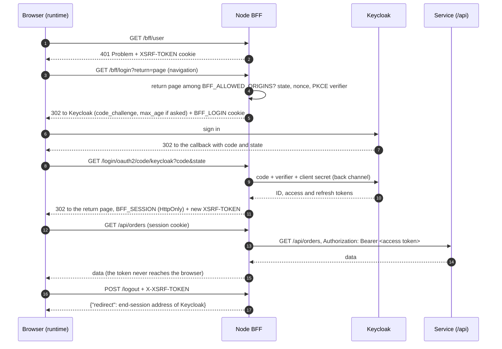

# Minimal Node BFF

A Backend for Frontend for Quadrava in one small Node service: the whole of `contracts/bff.yaml` (0.6.0, with the
operational roles and without tenants) and the `/authz` part of `contracts/authz.yaml` (0.2.0), on Node 24 with `openid-client` as its only dependency
(ADR-27). Under 1,000 lines of plain JavaScript in `src/`, comments included, to read in one sitting and change.

**An example to start from, not meant for production as it is.** Sessions live in the memory of the process: they are
lost at restart and not shared between instances. See [What it does not do](#what-it-does-not-do). A real application
uses the reference BFF on authz-library (`../bff`, ADR-26) or its own BFF that follows the same contract.

It is plain JavaScript (ES modules with JSDoc types), like the tools in `frontend/tools`: no build step, and
`node src/server.mjs` runs exactly the files you read. Node's type stripping would allow TypeScript, but nothing in
this repository runs `.ts` files directly, and a reader would then need to know which TypeScript Node accepts.

## How it works



| Path | What it does |
| --- | --- |
| `GET /bff/login?return=…&max_age=…` | Starts the login: Authorization Code with PKCE (S256), `state` and `nonce`. `return` must be an address whose origin is in `BFF_ALLOWED_ORIGINS` (otherwise 400 in Problem format: no open redirect); without it the user lands on `BFF_HOME`. `max_age` goes to Keycloak, which then asks for the credentials again if its own login is older, even inside a session. With a session and no `max_age` it goes straight back. |
| `GET /login/oauth2/code/keycloak` | The callback (`BFF_CALLBACK_PATH`). The login must have been started by the same browser (a `BFF_LOGIN` cookie bound to the `state`; a `state` works once). openid-client checks the state, PKCE, the ID token, the nonce and, with `max_age`, the time of the authentication. A new session identifier at every login. |
| `GET /bff/user` | `name`, `username`, `email`, `roles` and, for a user with operational roles, `operationalRoles` and `currentRole`: never tokens. |
| `POST /bff/role` | `{"role": "<id>"}` with the CSRF token: the session works as another of the user's operational roles (ADR-28). `204`, `404` for a role not offered, `400` for another body. |
| `POST /logout` | A write: session and CSRF token needed. Closes the session and answers `{"redirect": …}` with the end-session address of Keycloak (`id_token_hint`, back to the application that asked, or `BFF_HOME`), which ends the Keycloak session too. Without `Accept: application/json` it redirects there. |
| `GET /authz/capabilities?app=…` | The permissions of the session, sorted, and their `version` (also in `X-Permissions-Version`). A `role` in the query is ignored: the answer is for the active role of the session. |
| `GET /authz/roles?app=…` | The roles of the user that the permissions file knows, with `label` and `base`. |
| `POST /authz/check` | `{"checks": [...]}`, at most 200: one result per check, in order, with the resource echoed. A write like any other: CSRF token needed. A `role` in the body is ignored, as for the capabilities. |
| `/api/...` (`BFF_ROUTES`) | Forwarded to the service with the access token and the active role in `X-Active-Role`. |

Rules that hold for every call:

- **No session, no redirect.** Any call without a session answers `401` in Problem format; the runtime starts the login.
  With a session, an unknown path answers `404`.
- **Session cookie** `BFF_SESSION`: `HttpOnly`, `SameSite=Lax`, `Path=/`, `Secure` when the BFF is reached over HTTPS
  (see `BFF_TRUST_PROXY`). Sessions end after 30 minutes without calls or 10 hours in all.
- **CSRF, double submit.** The `XSRF-TOKEN` cookie (readable by the page) comes with the first answer, also to a
  visitor without a session, and is replaced at the login by the token of the session. Every `POST`, `PUT`, `PATCH`
  and `DELETE` must carry the token of the session in `X-XSRF-TOKEN`, compared in constant time: `403` otherwise (`401`
  without a session). A write whose `Origin` is neither the BFF nor one of `BFF_ALLOWED_ORIGINS` is refused too.
- **Paths with `..`, `%2e`, `%2f` or `\`** are refused with `400` before anything else.
- **Errors** are Problems (`application/problem+json`, `title` and `status`); a Problem of a service passes as it is.

### Roles and permissions

The roles come from the access token (`BFF_ROLES_CLAIM`, `realm_access.roles` for the realm roles of Keycloak) and are
kept at the login. Only the roles named in the permissions file count: they are the `roles` of `/bff/user`. A user
with none of them signs in with no permissions. The file ([`permissions.json`](permissions.json), the same roles as
the reference `authz` service) lists the permissions of each role in the format `domain.resource.action`, for every
application the BFF serves. A role is a list of permissions, or an object with a `label` and the `base` flag
(ADR-28):

```json
{
  "user": { "label": "User", "base": true, "permissions": ["showcase.components.read"] },
  "clerk": { "label": "Clerk", "permissions": ["orders.order.create"] },
  "approver": ["orders.order.approve"]
}
```

**Operational roles.** A base role always applies. The other roles are operational: the session works as one of them
at a time, and its permissions are those of the base roles plus that one. At the login the BFF opens the session on
the role the user worked as last (remembered in memory, per user) or the first; it never asks. `/bff/user` lists the
choices (`operationalRoles`, `currentRole`), `POST /bff/role` switches, `/authz` answers for the active role whatever
`role` the page sends, and `/api` receives it in `X-Active-Role`. A user without operational roles has all the
permissions of their roles and no role fields. In the development realm the administrator holds `administrator` and
`manager`, so the user menu of the runtime offers the choice (with `services.roleSwitchUrl`, set in the BFF
configuration of the runtime).

The version of the permissions is a hash of the active role and of the list: it changes with a switch, and when the
file changes and the user signs in again. Permissions are a help for the interface only: the services check every call
themselves.

### Forwarding

Each route of `BFF_ROUTES` (`/api` by default) goes to its service:

- the request carries the user's access token (`Authorization: Bearer`), renewed with the refresh token when it has
  less than 30 seconds left (one renewal for concurrent calls; if it fails the session ends and the call gets `401`);
- only `Accept`, `Accept-Language`, `Content-Type`, `If-None-Match`, `If-Match`, `If-Modified-Since`, `traceparent`,
  `tracestate` and `baggage` pass: never the cookies of the browser nor its own `Authorization` or `X-Active-Role`;
- the active role of the session, if any, goes in `X-Active-Role`;
- only status, body, `Content-Type`, `ETag`, `Cache-Control`, `Last-Modified` and `Content-Disposition` come back; not
  the cookies of the service, nor its `X-Permissions-Version` (the version is that of the session);
- bodies are streamed both ways, up to `BFF_MAX_BODY_BYTES` (`413` beyond); a service that does not answer within 60
  seconds, or is down, gives `502`;
- an event stream (`text/event-stream`, the data sources with `live`) is written to the browser chunk by chunk as it
  arrives, with no time limit while it stays open, and with `X-Accel-Buffering: no` for an nginx in front.

## Running it

Node 24 (`.nvmrc`), and Keycloak of `idp/` running (`cd idp && docker compose up -d keycloak`; Redis is not used).

```bash
cd reference/bff-node
npm ci
npm start          # port 8080, the development defaults
npm test           # unit tests, no Keycloak needed
```

The BFF reads the discovery document of Keycloak at start-up and waits up to two minutes for it. It takes port 8080
and the callback `/login/oauth2/code/keycloak` that the development realm registers for the reference BFF, so it
replaces the reference BFF with no change to the realm: run one or the other, not both.

**With the runtime in development** (port 4200, its dev server forwards the BFF paths to 8080): start the demo back
end and the runtime instead of `npm run stack`, which starts the Java BFF.

```bash
cd frontend
npm run demo-api              # 8084
npm run start:runtime:bff     # 4200
```

**With the runtime image** (`docker/runtime/README.md`, «Against the local stack»): the image forwards the BFF paths
with its own `Host` and `X-Forwarded-*` headers, so the BFF must trust them to build the callback on port 8090:

```bash
BFF_TRUST_PROXY=true npm start
docker run -d --name quadrava-runtime -p 8090:8080 \
  -v "$PWD/frontend/projects/runtime/config/bff/runtime-config.json:/etc/quadrava/runtime-config.json:ro" \
  -e QUADRAVA_BFF_URL=http://host.docker.internal:8080 ghcr.io/sramaccini/quadrava-runtime:0.32.0
```

Then open http://localhost:8090 (or 4200) and sign in as `operator`, `manager` or `administrator` (password = user name).

**Conformance.** With the BFF running, from `frontend/`:

```bash
npm run conformance:bff -- --bff http://localhost:8080 --return http://localhost:4200/ --user administrator --password administrator
```

The authorization kit needs the session cookies; CI (job «Node BFF») gets them with `bffLogin` of
`tools/conformance-lib.mjs` and runs `conformance-authz.mjs --authz http://localhost:8080 --cookie … --other-cookie …`.
`npm run conformance` itself checks the reference services (authorization on 8082, telemetry on 8083), which this BFF
does not replace.

## Configuration

Environment variables. Those marked «development» have a default that only makes sense on a developer's machine: the
start-up log lists the ones in use.

| Variable | Meaning | Default |
| --- | --- | --- |
| `BFF_PORT`, `BFF_HOST` | Where it listens | `8080`, every interface |
| `BFF_ISSUER` | OpenID Connect issuer (discovery). An `http` address is accepted, for the development Keycloak: use `https` anywhere else | development: `http://localhost:8180/realms/quadrava` |
| `BFF_CLIENT_ID` | Confidential client | `quadrava-bff` |
| `BFF_CLIENT_SECRET` | Its secret | development: `dev-only-secret` (that of `idp/realm-quadrava.json`) |
| `BFF_SCOPE` | Scopes asked | `openid profile email` |
| `BFF_CALLBACK_PATH` | Path of the callback, registered at the provider | `/login/oauth2/code/keycloak` |
| `BFF_PUBLIC_URL` | Public origin of the BFF (`https://app.example`), for the callback and the `Secure` flag | taken from the request |
| `BFF_TRUST_PROXY` | `true` behind a proxy that sets `X-Forwarded-Proto` and `X-Forwarded-Host` (the runtime image, a TLS terminator); never when the BFF can be reached directly | `false` |
| `BFF_ALLOWED_ORIGINS` | Origins of the applications, separated by commas: return pages and `Origin` of writes | development: `http://localhost:4200,http://localhost:4201,http://localhost:8090` |
| `BFF_HOME` | After a login without `return`, and after the logout of an application that is not listed | development: `http://localhost:4200/` |
| `BFF_ROUTES` | Forwarded prefixes, `prefix=address` separated by commas, such as `/api=http://api:8084,/telemetry=http://telemetry:8083` | development: `/api=http://localhost:8084` |
| `BFF_PERMISSIONS_FILE` | Permissions per role | `permissions.json` of this folder |
| `BFF_ROLES_CLAIM` | Path of the roles in the access token | `realm_access.roles` |
| `BFF_SESSION_IDLE_MINUTES`, `BFF_SESSION_MAX_HOURS` | Limits of a session | `30`, `10` |
| `BFF_MAX_BODY_BYTES` | Largest request body forwarded | 100 MB |

The runtime of the demo also sends its telemetry to `/telemetry`: add `/telemetry=http://localhost:8083` to
`BFF_ROUTES` when the telemetry service runs; otherwise those calls get `404`.

## What it does not do

- **Sessions shared between instances**, or surviving a restart: they are in memory. One instance only; behind a load
  balancer, a shared store (Redis, as the reference BFF) is needed.
- **Back-channel logout**: when Keycloak closes its session elsewhere (another application, the console), the session
  of this BFF lives on until the refresh token is refused or it expires.
- **Tenants** (the optional part of `bff.yaml`): no `tenants` in the user and no `/bff/tenant`. The tenant checks of
  the kit are skipped.
- **Recent login required**: it never answers `urn:problem:authz:recent-login-required`; it only passes `max_age` on.
- **HTTPS by itself**: it speaks HTTP and expects a TLS terminator in front, with `BFF_TRUST_PROXY=true` or
  `BFF_PUBLIC_URL`.
- No list of the user's own sessions, no rate limiting, no metrics or traces of its own.
